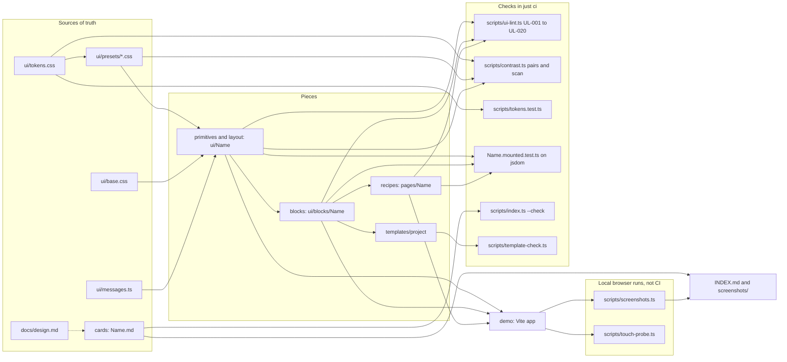
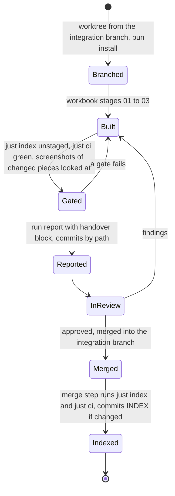
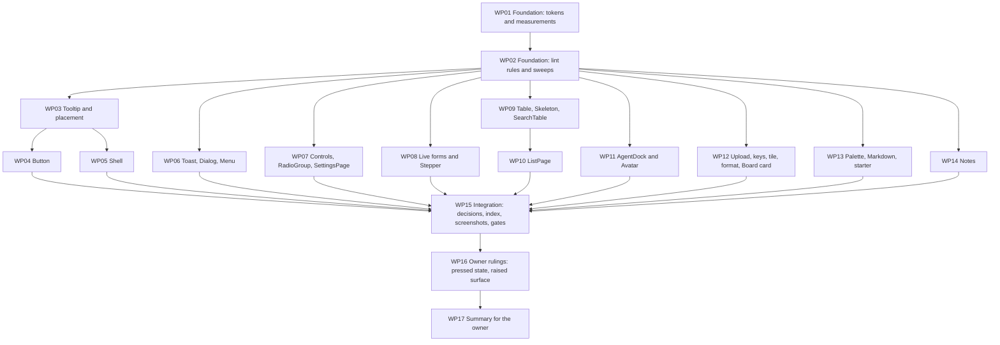
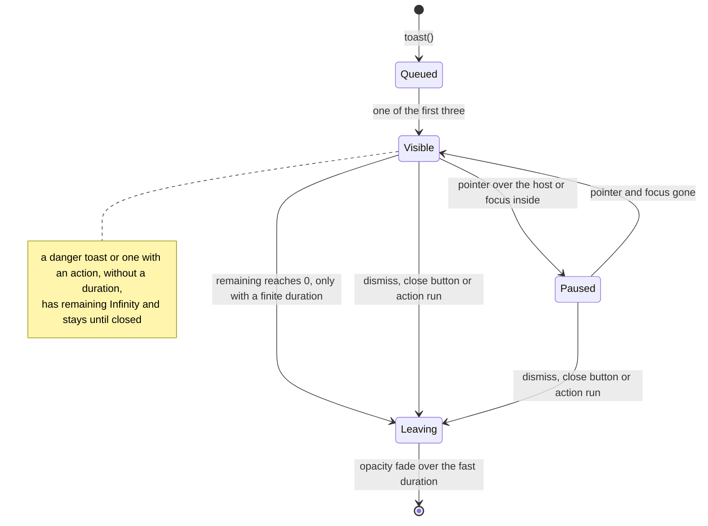
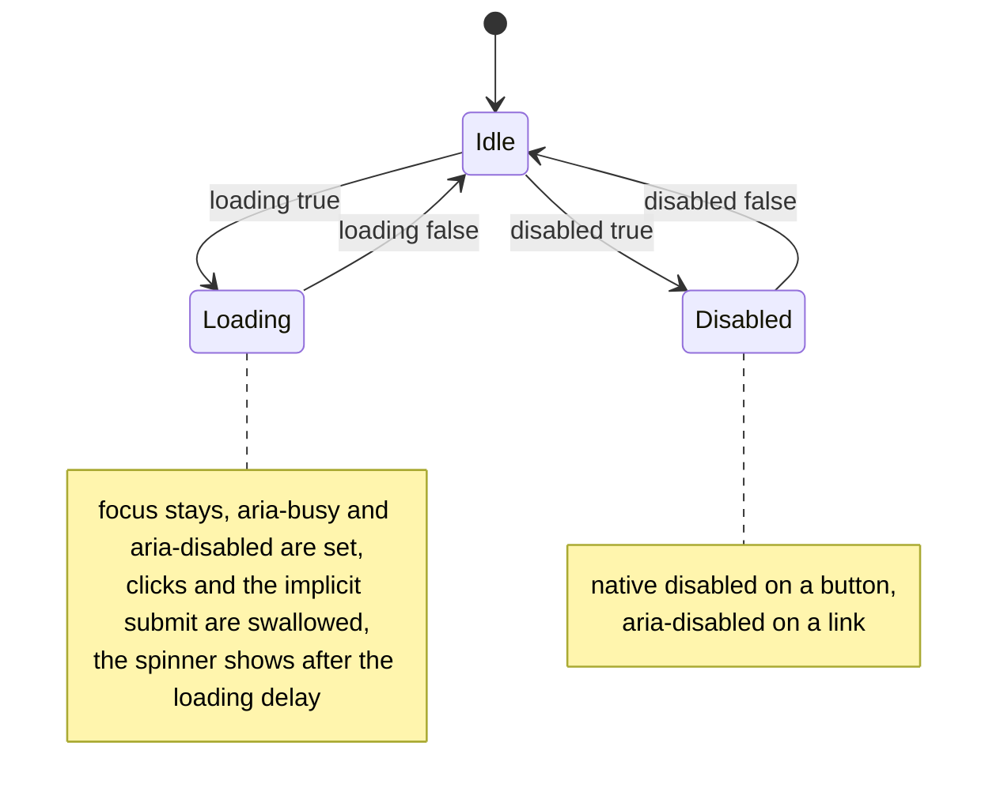
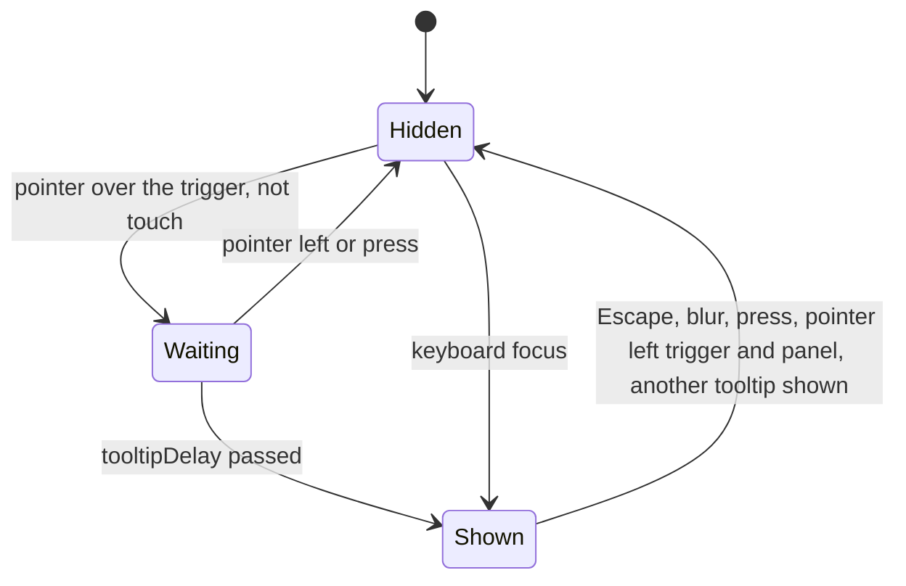

# UX hardening pass: implementation plan

Status: plan, 18.11.2026. Integration branch `task/govengers-ui-ux-overhaul` (from `main` d353ef1).
`main` is not touched until the owner has seen the result. Every work package is one run of
`workbooks/maintain-collection/` in its own worktree, branched from the integration branch and
merged back into it.

## 1. Goal

Close the places where the collection breaks its own stated rules (D9, D49, P7) or a published
standard, and add the checks that would have caught them. About 75 accepted changes, 65 of them
small: accessibility and touch defects, forms, feedback, loading, phone navigation, lint rules
and tests, two new pieces (`RadioGroup`, `Tooltip`).

It is not a redesign. No spacing ladder, type scale, radius tier, shadow recipe, gradient or focus
colour changes. The look moves only where a measured rule forces it (four `--ui-border-strong`
shades, the paper shadow direction, balanced headings) and in the two owner rulings of WP16.

Change ids (`04-B`: two digits for the topic, a letter for the change) are the ids of the accepted
list. This plan restates every instruction, so an implementer needs nothing but this file and the
repository.

## 2. Scope and non-goals

In scope: the changes listed per work package in section 8, the contracts in section 6.

Non-goals (rejected, do not build):

- Any look change beyond section 1: two-layer or tinted shadows, a larger overlay radius, a 1.1
  display line height, resting cards without shadow, a separate focus colour (D36 stays), a
  blurred dialog backdrop, name-hashed avatar colours.
- Pieces with no demand in a business application: slider, rating, colour picker, calendar, OTP
  boxes, password meter, card mask, tree view, charts, swipe actions, pull to refresh.
- Hover-reveal row actions, press scaling, animated popovers, tab overflow fades, resizable panes.
- Mounted tests that measure size or computed colour (the harness compiles no styles, D69);
  `popover="hint"` (not widely available); "select all matching" across pages.
- Touch-gesture JavaScript around the native dialog (P5).
- Anything an implementer finds on the way: it goes to the handover block (section 7.3), not
  into the diff.

## 3. Rulings (decided, binding)

1. **Touch heights** (`01-B`, `02-A`, `03-A`): one fix in `ui/tokens.css`, the
   `max(<density value>, var(--ui-touch-min))` form, covering `--ui-control-h`, `-sm` and `-lg` in
   both densities. `size="sm"` reaches 44 px on coarse pointers (D49 already says every control
   does). Token test `03-J`.
2. **Field text on touch** (`02-E`, `03-B`): one token, `--ui-field-text-min`. The text of Input,
   Select and Textarea is at least 1rem on coarse pointers in both densities. No precondition; the
   check on a real phone is on the owner's list (section 12).
3. **Shell viewport units** (`02-D`, `18-A`): one change, in WP02.
4. **Dialog entrance and exit** (`10-B`, `19-F`): one specification, the Sheet pattern (opacity
   plus a small translate, backdrop fade, `@starting-style`, `allow-discrete`), not for inline
   dialogs, reduced motion respected through `base.css`.
5. **Toast durations** (`07-A`, `08-J`): one rule,
   `duration ?? (action || variant === 'danger' ? Infinity : 5000)`. Tests `07-B`.
6. **Visible name of an icon-only Button** (`11-E`, `01-H`): through the new `Tooltip` piece
   (`10-C`) on hover and keyboard focus, not through the native `title` attribute. A browser shows
   `title` on mouse hover only, never on keyboard focus or touch, so a keyboard user does not get
   the name. (The ruling as handed over said `title` fails WCAG 2.2 SC 1.4.13; that criterion
   exempts tooltips the user agent draws. It binds the custom Tooltip instead: dismissable,
   hoverable, persistent.) The lint rule for a missing `label` stays.
7. **Lint rules proposed under clashing numbers**: one rule each, numbered here: `UL-004` colour
   function literal, `UL-005` literal font size, `UL-006` bare `vh`, `UL-007` unguarded `:hover`,
   `UL-013` icon-only Button without `label`.
8. **Owner rulings**: `01-E` (a pressed state for Button, colour step only) and `15-D`
   (`--ui-surface-raised` for overlays in dark themes) are in, as the separate package WP16 whose
   commits can be dropped without touching the rest (built; `15-D`'s raised ground was dropped in
   WP16's closing round because its step did not show). `09-K2`: no code change, one sentence on the
   Table card. All other open questions: no change.
9. Everything rejected is a non-goal. Defects found while reading are in section 13.

## 4. What reading the code changed

Measured or checked on the base commit while planning; an implementer starts from these facts.

| Finding | Consequence |
|---|---|
| `--ui-control-h: max(var(--ui-control-h), ...)` is a cycle and invalid | the coarse block repeats the density's literal values; `scripts/tokens.test.ts` pins that they equal the fine-pointer values |
| `--ui-border-strong`, measured with the functions of `scripts/contrast.ts`: below 3:1 in six pairs: neutral dark on `--ui-surface-2` 2.87; paper light on `--ui-bg` 2.86 and on `--ui-surface-2` 2.94; slate light on `--ui-bg` 2.98 and on `--ui-surface-2` 2.83; slate dark on `--ui-surface-2` 2.83 | confirms the hand computation of `16-D`; starting values in WP01 |
| `--ui-ink-2` on `--ui-surface-2` passes everywhere (7.4 to 10.1); `--ui-focus` on `--ui-surface-2` passes everywhere (4.05 to 7.11) | `16-B` and `10-M` add pairs, no token moves |
| A scan for same-rule `color` and `background` pairs finds four undeclared: `ink-2` on `surface-2` (Badge, StatusTile), `disabled-ink` on `sunk` (Input, Select, Textarea, disabled), `accent` on `border` (JobProgress bar on its track, 2.8 in neutral dark), `muted` on `sunk` (`Card.demo.vue`) | `16-C` lands with one new pair, two exemptions, demos skipped; section 13 |
| `DetailForm.submit` already focuses the first `[aria-invalid="true"]` after a refused save | `01-I` is a mounted test that pins it and one card line, no code change unless the test fails |
| `grep ':hover'` finds 25 rule lines in 19 files under `ui/` and `pages/` | the sweep list in WP02; `UL-007` is the completeness check |
| `NotificationInbox.vue:153` has `70vh` | it must become `70dvh` for `UL-006` to land clean |
| No icon-only `<Button>` lacks `label` today | `UL-013` lands with zero findings |
| `ui.more` exists; `rotate-ccw` is not in `icons.ts`, `refresh` is; `square`, `user`, `users`, `search`, `more-horizontal`, `alert-circle` exist | no new icon; no new `ui.more` |
| Native radio arrow keys are browser behaviour; jsdom does not move the selection | RadioGroup's mounted test covers change events and the shared name; the arrow path is a browser check in WP07 |
| `onBeforeRouteLeave` does nothing outside a routed component, and the mounted harness renders the piece beside the router, not in a `RouterView` | `useLeaveGuard` registers `router.beforeEach` for the life of the component |
| `01-C` hides the label at once and `06-B` delays the spinner | both switch at the same moment, after `--ui-loading-delay` (WP04) |
| A wrapper around `<button>` would move attribute fallthrough and the parent's scoped class off the button | Button renders `Tooltip` inside its root (WP03, WP04) |
| In neutral dark, `--ui-accent` and `--ui-danger` text fall below 4.5:1 on any ground lighter than `#1c1c20` (1.04:1 against `--ui-surface`) | `15-D` can only be a very small step in the default preset; WP16, open question 1 |
| `just ci` does not run `screenshots.ts --check`; the CI workflow does | WP15 runs it by hand; section 13 |
| A ghost Button in the shell's top bar paints `--ui-ink-2` on `--ui-chrome`: nearly invisible in light themes (see `screenshots/AppShell.light.png`); the demo's `.on-chrome` class loses to Button's own rule | the palette opener of `11-A` would be invisible; WP05 makes ghost Buttons in the `actions` slot read `--ui-on-chrome` |
| Stepper's frame is a native `<form>` and the demo's first field is `required` | the browser refuses the submit before `submit()` runs; `blocked` covers what only `canContinue` knows (WP08) |
| `SearchTable`, `FacetFilter` and `RangePicker` each write the URL from the route as it is; FacetFilter and RangePicker also follow the URL back into their model | clearing all three models in one tick lets the last writer restore the others; WP10 removes the keys of FacetFilter and RangePicker with one awaited write, sets their models (which then match the route and write nothing) and clears the search last, so SearchTable is the only writer left, of its own keys |
| `SearchTable`'s writer watches the route too and writes `{ query }` without path or hash | a write by the page that touched `search` or `page` would be undone at once, so the page never writes those keys; the hash is lost on its writes today (section 13) |
| RangePicker follows the URL only while `t` is present; a URL without it leaves the model alone | the page sets the range model itself after the write |
| In card mode `Table.phone.css` clips the header but leaves its sort buttons and the select-all box in the tab order, invisible | WP09 hides the header from focus and assistive technology in card mode, where SearchTable shows the replacements |
| `SettingsPage` keeps its form state across tab changes while its `DetailForm` unmounts | the leave guard belongs to the owner of the form state: `useLiveForm` registers it (WP08) |
| `scripts/test/setup.ts` exposes no `HTMLAnchorElement`, no `scrollTo`, no `matchMedia` | WP01 adds them, before the packages whose tests need them |
| The AppShell demo frame makes the top bar `position: static` inside a fixed-height `overflow: hidden` box | the sticky check needs its own scrolling fixture (WP05) |
| Nothing is pushed in this pass | the gate is local (`just index`, then `just ci`); the remote CI is not part of any package's definition of done (section 10) |
| No `node_modules` in a fresh worktree | every package starts with `bun install --frozen-lockfile` |

## 5. Architecture: what the pass touches and who checks it



No data model changes anywhere in this pass (no livewire resource, no stored shape), so the plan
has no entity diagram. The fake engine in `demo/src/fake/` is not extended.

## 6. Contracts: names an implementer builds against verbatim

### 6.1 Tokens (all in WP01 except the last two rows)

| Token | Value | Read by | Change id |
|---|---|---|---|
| `--ui-control-h`, `-sm`, `-lg` under `(pointer: coarse)` | `max(<density value>, var(--ui-touch-min))`, both densities | every control | `01-B` `02-A` `03-A` |
| `--ui-field-text-min` | `0px`; `1rem` under `(pointer: coarse)` | Input, Select, Textarea | `02-E` `03-B` |
| `--ui-loading-delay` | `400ms` | Skeleton, Button spinner | `06-B` |
| `--ui-sticky-top` | `0px`; AppShell sets `var(--ui-topbar-h)` | Table sticky header | `09-N` |
| `--ui-measure` | `65ch` | MarkdownView | `17-E` |
| `--ui-tooltip-w` | `16rem` | Tooltip | `10-C` |
| `--ui-duration-slow` | removed (no reader in the repository or the templates) | - | `19-A` |
| `--ui-border-strong` | neutral `light-dark(#8a8a93, #72727b)`; paper `light-dark(#87847b, #6f8184)`; slate `light-dark(#808798, #646d82)` (starting values, measured again in WP01, margin at least 3.05) | inputs, secondary buttons | `16-D` |
| `--ui-shadow-md`, `--ui-shadow-lg` in paper | `0 2px 6px rgb(30 42 46 / 0.14)`, `0 6px 18px rgb(30 42 46 / 0.22)` | overlays, Card hover | `15-A` |
| `--ui-accent-active`, `--ui-danger-active`, `--ui-surface-3` (WP16) | `color-mix(in srgb, var(--ui-accent-hover) 85%, var(--ui-ink))`, `color-mix(in srgb, var(--ui-danger-hover) 85%, var(--ui-ink))`, `color-mix(in srgb, var(--ui-surface-2) 92%, var(--ui-ink))` | Button `:active` | `01-E` |
| `--ui-tabbar-h` (WP15) | `3.375rem` | AppShell's phone bar | WP05 handover |
| `--ui-sticky-bottom` (WP15) | `0px`; AppShell sets `var(--ui-tabbar-h)` on the root under 48rem, not with `bare`; Dialog and Sheet set it again on their bodies | ActionBar, the collapsed dock strip, the page's scroll padding under a sticky ActionBar | WP05 handover, WP08 review |
| `--ui-surface-raised` (WP16) | neutral `light-dark(var(--ui-surface), #1c1c20)`; paper `light-dark(var(--ui-surface), #222f30)`; slate `light-dark(var(--ui-surface), #181d29)` | Popover, Toast, Dialog, Sheet, CommandPalette (Tooltip inverts instead, WP16) | `15-D` |

### 6.2 Lint rules (WP02)

| Rule | Where | Fails on | Message |
|---|---|---|---|
| `UL-004` | every style block | `/\b(rgba?\|hsla?\|hwb\|lab\|lch\|oklab\|oklch\|color)\(/i`; `color-mix(` with token arguments passes | `colour literal: use a var(--ui-*) token` |
| `UL-005` | every style block | a `font-size:` whose value holds a number followed by `px`, `rem`, `pt` or `vw`; `var(--ui-text-*)`, `em`, `%`, `inherit` and `max(var(--ui-field-text-min), 1em)` pass | `literal font size: use var(--ui-text-*)` |
| `UL-006` | every style block | a number directly followed by `vh` (`dvh`, `svh`, `lvh` do not match) | `vh: use dvh (svh for a fixed height)` |
| `UL-007` | every style block | a selector with `:hover` outside an `@media` whose query holds `hover: hover` (at-rule stack by brace depth) | `unguarded :hover: wrap the rule in @media (hover: hover)` |
| `UL-013` | every template in the linted directories, demos included | a `<Button ...>` whose content up to `</Button>` is only a `<template #icon>` and which has no `label=` or `:label=` (an `aria-label` alone names the button but shows no tooltip, so it does not pass) | `an icon-only Button carries label` |

`tokens.css`, `base.css` and presets stay exempt as today. The header comment lists the rules and
loses the false sentence that `templates/project/ui-lint.ts` is a copy (`scripts/template-check.ts`
copies `scripts/ui-lint.ts`).

### 6.3 `ui.*` message keys (all added by WP01, `en` and `de`)

| Key | en | de | Used by |
|---|---|---|---|
| `ui.copyFailed` | Copy failed. Select the key and copy it by hand. | Kopieren fehlgeschlagen. Schlüssel markieren und von Hand kopieren. | WP12 `01-D` |
| `ui.leaveUnsaved` | You have unsaved changes. Leave this page? | Es gibt ungespeicherte Änderungen. Seite verlassen? | WP08 `04-C` |
| `ui.skipToContent` | Skip to content | Zum Inhalt springen | WP05 `10-J` |
| `ui.mainNav` | Main | Hauptnavigation | WP05 `10-J` |
| `ui.paletteOpen` | Search | Suchen | WP13 `11-A` |
| `ui.paletteNoResultsHint` | Check the spelling or try fewer words | Schreibweise prüfen oder weniger Wörter eingeben | WP13 `11-C` |
| `ui.removeFailed` | Could not remove {name}. Try again. | {name} konnte nicht entfernt werden. Erneut versuchen. | WP12 `13-D` |
| `ui.retryFile` | Retry {file} | {file} erneut hochladen | WP12 `22-A` |
| `ui.jumpToLatest` | Jump to latest | Zum Neuesten springen | WP11 `21-A` |
| `ui.unknownPerson` | Unknown person | Unbekannte Person | WP11 `21-D` |
| `ui.sortBy` | Sort by | Sortieren nach | WP09 `09-F` |
| `ui.sortAscending` | Ascending | Aufsteigend | WP09 `09-F` |
| `ui.sortDescending` | Descending | Absteigend | WP09 `09-F` |
| `ui.clearFilters` | Clear filters | Filter zurücksetzen | WP10 `13-B` |
| `ui.keyCtrl` | Ctrl | Strg | WP15 (WP13 handover): starter `App.vue`, MarkdownEditor |
| `ui.conversation` | Conversation | Unterhaltung | WP15 (WP11 handover): AgentDock's log |
| `ui.signOut`, `ui.signingOut`, `ui.signOutSlow`, `ui.signOutFailed` | Sign out; Signing out; Signing out takes longer than usual. You may still be signed in.; Could not sign out. You are still signed in. | Abmelden; Wird abgemeldet; Das Abmelden dauert länger als üblich. Du bist vielleicht noch angemeldet.; Abmelden fehlgeschlagen. Du bist weiterhin angemeldet. | WP15 (WP13 handover): starter `App.vue`, `router.ts` |

Existing keys reused: `ui.more` (More tab), `ui.stop` (AgentDock), `ui.selectAll`, `ui.search`,
`ui.copied`, `ui.tooManyFiles`. Page keys live in the page folder (WP07, WP10).

### 6.4 Props, events, functions, classes

| Name | Signature or shape | Package |
|---|---|---|
| `place` in `ui/Popover/place.ts` | `place(anchor: Element, panel: HTMLElement, options: { placement: 'auto' \| 'bottom' \| 'top' \| 'end'; align: 'start' \| 'end'; matchWidth: boolean; gap: number }): void`; Popover's code moved, plus the `end` side (inline-end of the anchor, centred on it) | WP03 |
| `Tooltip` props | `text: string`, `kind?: 'description' \| 'label' \| undefined` (default `description`), `placement?: 'auto' \| 'bottom' \| 'top' \| 'end' \| undefined` (default `auto`); default slot: one element, optional | WP03 |
| `tooltipDelay`, `tooltipGrace` in `ui/Tooltip/tooltip.ts` | `export const tooltipDelay = 500` (milliseconds before a hovered tooltip shows), `export const tooltipGrace = 100` (milliseconds a tooltip survives after the pointer left, so the pointer can cross the gap to the panel) | WP03 |
| Button | no new prop; `data-state="loading"` while loading; `aria-disabled="true"` while loading or when a link is disabled | WP04 |
| `ToastOptions.duration` default | `duration ?? (action \|\| variant === 'danger' ? Infinity : 5000)` | WP06 |
| Toast transition classes | `ui-toast-leave-active`, `ui-toast-leave-to`, `ui-toast-move` | WP06 |
| `RadioGroup` props | `modelValue?: string \| number \| null \| undefined`, `options: { value: string \| number; label: string; description?: string; disabled?: boolean }[]`, `name?: string \| undefined` (default a generated id), `disabled?: boolean \| undefined`; emits `update:modelValue: [value: string \| number]`; classes `ui-radio-group`, `__option`, `__control`, `__text`, `__description` | WP07 |
| `settle` on `LiveFormState` | `settle(name: string): void` | WP08 |
| `useLeaveGuard` in `ui/blocks/LiveForm/leaveGuard.ts` | `useLeaveGuard(dirty: Ref<boolean>): void`; called by `useLiveForm` unless the new option `leaveGuard?: boolean \| undefined` is `false` | WP08 |
| Stepper event | `blocked: []` | WP08 |
| Table prop and expose | `loadingRows?: number \| undefined` (default 5); `defineExpose({ toggleAll, allChosen, someChosen })` (the two computed refs the header checkbox already uses) | WP09 |
| SearchTable prop | `searchLabel?: string \| undefined` (default `t('ui.search')`); class `ui-search-table__sort` | WP09 |
| `nearBottom` in `dock.ts` | `nearBottom(scrollTop: number, scrollHeight: number, clientHeight: number, slack: number): boolean` | WP11 |
| AgentDock | prop `cancel?: MutationTarget<NoParameters, undefined, unknown> \| undefined` (as built; no body); `ChatMessage.streaming?: boolean` | WP11 |
| `Upload` in `fileUpload.ts` | gains `file: File \| undefined` (released once the upload succeeded), `retryable: boolean` (false when the server refused the file with field errors), `replaces: Entry \| undefined` (the row a single-file upload replaces once it succeeds) | WP12 |
| StatusTile prop | `period?: string \| undefined` | WP12 |
| `formatCurrency` | `formatCurrency(value, locale, currency, options: Intl.NumberFormatOptions = {})` | WP12 |
| `highlight` in `palette.ts` | `highlight(label: string, query: string): { text: string; match: boolean }[]`; class `ui-command-palette__match` | WP13 |
| AppShell | class `ui-app-shell__more`, attribute `data-overflow` on nav items past the fourth | WP05 |
| Button custom property (WP15) | `--ui-button-ghost-ink`: the ghost variant's text at rest, `var(--ui-button-ghost-ink, var(--ui-ink-2))`; AppShell sets it on `.ui-app-shell__actions`, `initial` inside `[popover]` and `dialog` there | WP15 (D102) |
| `logout` in the starter's `router.ts` (WP15) | `logout(t: (key: string) => string): Promise<void>`; App.vue passes its `t` | WP15 |
| `undeclaredPairs`, `exemptPairs` in `scripts/contrast.ts` | `undeclaredPairs(source: string): { fg: string; bg: string; selector: string }[]`; `exemptPairs: { fg: string; bg: string; why: string }[]` | WP01 |
| Page keys | `settings.danger.mismatch`; `customers.list.actions.deleteN`, `customers.list.emptyFirst`, `customers.list.emptyFirstHint`, `customers.list.searchLabel` | WP07, WP10 |

### 6.5 Decisions (next free number is D84)

The paragraph is the text to write, adjusted only where the build differs (then the handover says
how). As written by WP15 (19.11.2026): D90 to D100 take the text of each package's newest handover
block, so the rows below are the plan, not the record; `docs/design.md` is the record. WP10's
decision took D101, the ghost ink property D102, the test budget of its fix round D103, and WP16's
two moved to D104 and D105. WP16 added D106 (the Tooltip) in its run, and its closing round dropped
the raised ground by revert commits: D105 stays unused, D106 keeps its number. Section
heading in `docs/design.md`: `## UX hardening (<date of WP01>)`.

| No. | Package | Text |
|---|---|---|
| D84 | WP01 | **The touch floor holds for every size and every density.** Under `(pointer: coarse)` the three control heights are `max(<the density's value>, var(--ui-touch-min))`, declared after the compact block for both densities, so `size="sm"` and compact controls reach 44 px too (WCAG 2.2 SC 2.5.5). D9 and D49 promised it; the old block set `sm` to 36 px and lost to the compact selector. A preset does not set the control heights: one that did would undercut this block (none does). The text of Input, Select and Textarea is at least `--ui-field-text-min` (0 on fine pointers, 1rem on coarse ones), because phone browsers zoom the page when a focused field's text is smaller than 16 px. `scripts/tokens.test.ts` resolves the tokens for both pointers and both densities. Amends D38, D49. |
| D85 | WP01 | **A line is measured against every ground it sits on.** `--ui-border-strong` reaches 3:1 (WCAG 2.2 SC 1.4.11) on `--ui-bg`, `--ui-surface` and `--ui-surface-2` in every preset and theme; four values moved. `just contrast` also scans the style blocks of `ui/` and `pages/`, the demos excepted, and fails on a rule that sets `color` and `background` to a token pair nobody declared. It sees pairs inside one rule only; `exemptPairs` names what is left out and why. Amends D16. |
| D86 | WP01 | **Token housekeeping.** `--ui-duration-slow` is removed: no piece, page or template ever read it; a project that reads it in its own styles declares it in its preset. New tokens: `--ui-loading-delay`, `--ui-sticky-top`, `--ui-measure`, `--ui-tooltip-w`, `--ui-field-text-min`. The typography, shape, elevation and motion blocks say in a comment what each step is for; ink tokens stay solid colours because the contrast script can measure nothing else (P7). Paper's shadows fall straight down like the other presets'. Headings wrap balanced. Amends D6. |
| D87 | WP01 | **Local browser probes are scripts.** `scripts/touch-probe.ts` (`just touch-probe`) opens every demo in a touch context, in both densities, and lists every control under 44 by 44 CSS px. A control placed off the page, cut off by an ancestor's hidden overflow or visually hidden is not a target; an input counts with its label's box, nothing else inside a label does. Two lists in the script keep it honest: `exempt` names the exceptions of WCAG 2.2 SC 2.5.5 (links in a sentence) and boxes that take no pointer action (a disabled task box), `known` names the targets that were too small when the probe was written and are not fixed yet, each with its measured width and height. The probe fails on anything else, on a known target that measures smaller than its record on a side under 44 px, and, over every demo, on an entry that matches nothing, so it catches a regression without hiding a debt and no waiver outlives its target. The records hold for the system font of the machine that measured them; on another operating system or font they are measured again, never lowered to make a run pass. It runs locally like the screenshots, never in CI (D46, D69). Amends D69. |
| D88 | WP01 | **The bulk bar and the row menu are parts, not pieces.** The bar lives in `Table.vue` (`ui-table__bulk`: count, Clear, the `bulk` slot); the row menu is `Menu` through SearchTable's `rowActions`. D32 and D34 name them as pieces. Amends D32, D34. |
| D89 | WP02 | **Five more mechanical rules.** `UL-004` colour function literals, `UL-005` literal font sizes, `UL-006` bare `vh`, `UL-007` `:hover` outside `@media (hover: hover)`, `UL-013` an icon-only Button without `label`. A touch screen keeps `:hover` on the last element tapped (MDN, `hover` media feature), so hover rules live inside the media query; `100vh` is taller than the visible area while a phone's browser bar shows (CSS Values and Units Level 4, large and dynamic viewport units), so heights use `dvh`. The rules read no comments and no quoted strings: a size or a colour in prose is not a value. A target project gets the rules with its next copy of `ui-lint.ts`. Amends D12, D47. |
| D90 | WP03 | **Tooltip is the one hint on hover and focus.** `ui/Tooltip` shows one plain sentence: after `tooltipDelay` on a hovering mouse or pen, at once on keyboard focus; it stays while the pointer is on it and leaves on Escape, blur, a press on the trigger or `tooltipGrace` after the pointer left (WCAG 2.2 SC 1.4.13, APG Tooltip pattern). It is `popover="manual"`: `hint` is not widely available and `auto` would close an open menu. Two forms: around one element, or as a child of its trigger. Touch shows nothing, so a tooltip never carries what the user needs. The placement code is `ui/Popover/place.ts`, shared with Popover. The native `title` attribute is not used for names. Amends D51. |
| D91 | WP04 | **A loading Button keeps its focus.** `loading` sets `aria-busy` and `aria-disabled` and swallows clicks and the form's implicit submit; native `disabled` is for `disabled` only, because a disabled button drops focus to the body (APG, focusability of disabled controls). The spinner covers the content after `--ui-loading-delay`, so the width does not change and a fast answer shows nothing. An icon-only Button shows its `label` through Tooltip. Amends D44. |
| D92 | WP05 | **Phone navigation reaches everything.** Under 48rem, with more than five items or a `navFooter`, the bar shows the first four items and a More tab that opens a Sheet with the rest and the footer (WCAG 2.2 SC 1.4.10: no content is lost when the layout reflows). The skip link and the nav's name are `ui.*` keys (D44). The shell sets `--ui-sticky-top` to the top bar's height. The rail shows item names through Tooltip. Ghost Buttons in the `actions` slot read `--ui-on-chrome`. |
| D93 | WP06 | **How long a toast stays.** `duration ?? (action \|\| variant === 'danger' ? Infinity : 5000)`: an error or a toast with a follow-up stays until closed (WCAG 2.2 SC 2.2.1), anything else five seconds, any number overrides. Three open toasts that stay hold the queue; that is intended. A toast fades out in `--ui-duration-fast`. |
| D94 | WP06 | **Dialog enters and leaves like Sheet.** Opacity and a small translate on the panel, a fading backdrop, `@starting-style` and `allow-discrete` for `display` and `overlay`; not for `inline`; `base.css` cuts it under reduced motion. Where `@starting-style` is missing the dialog appears as before. |
| D95 | WP07 | **Native validity shows once the user has been in the field; radios are RadioGroup.** Controls paint the invalid border on `:user-invalid` beside the `error` from the server. `ui/RadioGroup` is the one radio piece: native inputs under one name inside `Field group`, a default selection always. A typed-name confirm keeps its Delete enabled and refuses with a field error. |
| D96 | WP08 | **A form's submit is never disabled, and edits are not lost silently.** Stepper's Continue stays enabled. A field with a native constraint is refused by the browser, which focuses it and says why; a step that only `canContinue` refuses emits `blocked`, and the page shows why next to the field. `useLiveForm` registers `useLeaveGuard`, which asks before a navigation to another path or a page unload while the form is dirty; the guard lives as long as the form state, not as long as the card that shows it. A refused field's error clears once the user leaves it with another value than the one the server refused (`settle`). Amends D33. |
| D97 | WP09 | **Placeholders wait and match what comes.** Skeleton shows after `--ui-loading-delay`; Table's loading rows are Skeleton, as many as `loadingRows`, which SearchTable sets to its page size. A sticky table header sits at `--ui-sticky-top`. When the Table turns into cards, SearchTable shows a sort control and Select all, because the header that carried them is hidden. |
| D98 | WP11 | **The dock follows the stream only from the bottom, and an answer can be stopped.** AgentDock scrolls to the newest text only while the reader is at the bottom, else it offers "Jump to latest"; a message the user sends always scrolls. With a `cancel` call the send button is Stop while an answer streams, and Enter sends nothing until it ended. Amends D25. |
| D99 | WP12 | **A failed upload can be retried.** FileUpload keeps the `File` of an upload and offers Retry on a failed row, from byte 0, unless the server refused the file with field errors (`retryable`). A retried replacement still replaces: the old file goes only once the new one is in. The row shows the percentage while the runtime reports one. Amends D76. |
| D100 | WP13 | **The starter restores scroll and shows the palette.** `router.ts` returns to the saved position once the page is tall enough (live rows arrive after the navigation), to a hash below the top bar, stays where it is when only the query changed (filters, tabs), else goes to the top. The shell has a visible Search button for the palette with its shortcut. Amends D61, D74. |
| D101 | WP10 (number from WP15) | **An empty state speaks only for the query it read.** Text as written in `docs/design.md` (WP10's handover plus SearchTable's step back from WP15). Amends D32. |
| D102 | WP15 | **Button offers `--ui-button-ghost-ink`.** Text as written in `docs/design.md`. Amends D92. |
| D103 | WP15 (fix round) | **The two-second budget is the edit loop's.** Text as written in `docs/design.md`. Amends D69. |
| D104 | WP16 | **Button has a pressed state.** `:active` paints one step past hover through `--ui-accent-active`, `--ui-danger-active` and `--ui-surface-3`, derived with `color-mix()` so presets need no edit; `scripts/contrast.ts` resolves `color-mix(in srgb, ...)` and measures the text on them. No scaling. |
| D105 | WP16 | **Overlays sit on `--ui-surface-raised`.** Popover, Toast, Dialog, Sheet, CommandPalette and Tooltip paint it: `--ui-surface` in light themes, a step lighter in dark ones, as light as the text pairs on it allow. Amends D6, D37. |
| D106 | WP16 (decided in the run) | **The Tooltip inverts the page.** Text as written in `docs/design.md`. Amends D90. |

## 7. Collision points and how they are avoided

### 7.1 Ownership rule

A package stages only the files of its own list in section 8 (never `git add -A`). Two packages
that may run at the same time never share a file. Where a file is needed by many, one early
package owns all of its changes.

| Shared file | Rule |
|---|---|
| `ui/tokens.css`, `ui/base.css`, `ui/presets/*` | every change lands in WP01, including tokens that later packages read. Exception: WP16 adds its own tokens, alone, last. |
| `ui/messages.ts` | every new `ui.*` key lands in WP01 (section 6.3). Later packages only read. A key that turns out to be missing goes to the handover, WP15 adds it. |
| `ui/Icon/icons.ts` | no change in this pass. |
| `scripts/ui-lint.ts`, its test | all five rules land in WP02, with the sweeps that make the tree pass them. |
| `scripts/contrast.ts`, its test | pairs and scan in WP01; WP16 adds its pairs and the `color-mix` resolver, alone. |
| `scripts/screenshots.ts`, `scripts/test/setup.ts`, `justfile`, `workbooks/maintain-collection/stages/04-gates/CONTEXT.md` | WP01 only. A later package that needs one more DOM name in the harness shims it inside its own test file and reports it in the handover. |
| `docs/design.md` | WP01 creates the section and writes D84 to D88; WP02 appends D89 (it runs alone, after WP01). WP03 to WP14 do not touch the file: their paragraph travels in the handover and WP15 appends D90 to D103 in number order (D101 WP10's, D102 and D103 its own). WP16 appends D104 and D105 itself, each after a blank line. |
| `journal/<yyyy-mm>.md`, `TODO.md`, `README.md` (tier table) | WP01, WP02, WP15, WP16 and WP17 write them directly (they never run beside another package). WP03 to WP14 put the journal line, TODO lines and README names into the handover; WP15 applies them. |
| `journal/runs/*.md` | one file per package, unique name: `<yyyy-mm-dd>-maintain-collection-ux-wp<nn>-<slug>.md`. No collision. |
| `INDEX.md` (generated) | never staged in a package. In a package worktree run `just index` before the gates and leave the file modified and unstaged. After each merge into the integration branch, the merge step runs `just index` and commits `INDEX: regenerated after WP<nn>` when it changed. |
| `screenshots/*.png` (generated, binary) | never staged in WP01 to WP14. A package renders `bun scripts/screenshots.ts --only=<Name>` for what it changed, looks at both files (gate), and leaves them unstaged. WP15 renders everything once and commits; WP16 commits the files its own change moves. |
| Card of a piece owned by another package | the line goes to the owner package (stated in section 8), not to the package that caused it. |

### 7.2 Why decisions and journal lines wait for WP15

Appending to the end of the same file from two parallel branches conflicts in git by
construction. Packages running alone write directly; the parallel ones hand their text over. The
decision numbers and texts are fixed in section 6.5, so nothing is left to chance: a package
confirms its paragraph or states the difference.

### 7.3 The handover block

Every run report of WP03 to WP14 ends with this section (besides the template of
`journal/runs/README.md`):

```markdown
## Handover
decision: <"Dnn as planned" | "Dnn, changed: <the full paragraph>" | none>
journal: <dd.MM.yyyy maintain-collection ux-wp<nn>-<slug> - <outcome>; run report <file>>
readme: <names to add to the tier table | none>
todo: <one line per unrelated defect seen | none>
keys: <ui.* keys that were missing | none>
screenshots: <names of the pieces whose look changed>
probes: <what was measured in a browser and the result>
```

### 7.4 Lifecycle of a package



A reviewer of a package branch runs `just index` first; without it `index-check` fails on a branch
that changed a card's front matter, by design of 7.1.

Interim state of the branches, stated so nobody is surprised: nothing is pushed in this pass, so
the remote CI never sees a package branch. A package branch is green under the local gate
(`just index`, then `just ci`) and is not expected to pass `index-check` or
`screenshots.ts --check` from a clean checkout. The integration branch passes `just ci` from a
clean checkout after every merge step (the merge step commits `INDEX.md`). It passes
`screenshots.ts --check` from WP15 on; between the merge of the first new piece (WP03 or WP07)
and WP15 the screenshots of the new pieces are missing by design. The integration branch is
pushed, if the owner says so, only after WP17, when every remote CI step holds.

## 8. Work packages

Sizes: S under half a day of agent work, M about a day, L more. Gates for every package: section
10. "Card" means the piece's `<Name>.md`.



Order and concurrency:

- Wave 0, one after the other: WP01, then WP02. Everything else builds on them or would collide
  with their sweeps.
- Wave 1, all at the same time after WP02 is merged: WP03, WP06, WP07, WP08, WP09, WP11, WP12,
  WP13, WP14.
- Wave 2, at the same time: WP04 and WP05 once WP03 is merged; WP10 once WP09 is merged.
- Wave 3, one after the other: WP15, WP16, WP17.

### WP01 Foundation: tokens and measurements (L)

Ids: `01-B` `02-A` `03-A` (ruling 1), `03-J`, `02-E` `03-B` (ruling 2), `02-B`, `16-A`, `16-B`,
`16-C`, `16-D`, `10-M`, `15-A`, `15-F` (token comments), `16-F`, `17-D`, `19-A`, `19-C`, `18-C`,
`09-A`, the tokens of `06-B`, `09-N`, `10-C`, `17-E`, all keys of 6.3. Decisions D84 to D88.

Files: `ui/tokens.css`, `ui/base.css`, `ui/presets/paper.css`, `ui/presets/slate.css`,
`ui/messages.ts`, `ui/Input/Input.vue`, `ui/Input/Input.md`, `ui/Select/Select.vue`,
`ui/Select/Select.md`, `ui/Textarea/Textarea.vue`, `ui/Textarea/Textarea.md`,
`scripts/contrast.ts`, `scripts/contrast.test.ts`, `scripts/tokens.test.ts` (new),
`scripts/touch-probe.ts` (new), `scripts/screenshots.ts`, `scripts/test/setup.ts`, `justfile`,
`workbooks/maintain-collection/stages/04-gates/CONTEXT.md`, `docs/design.md`, `TODO.md`,
`journal/`.

Measure first, then fix (P7). Steps in this order:

1. **Touch probe** (`02-B`): `scripts/touch-probe.ts`. Reuse the demo server and card discovery of
   `scripts/screenshots.ts` (export what it has, do not copy). A Playwright context with
   `hasTouch: true, isMobile: true`, viewport 390 by 844; fail at once when
   `matchMedia('(pointer: coarse)').matches` is false. For every demo route, with the default
   density and with `document.documentElement.dataset.density = 'compact'`, collect inside
   `article.demo`: `button, a[href], input:not([type=hidden]), select, textarea, [role=tab],
   [role=menuitem], label:has(input)`; keep the visible ones; an element passes when its box, or
   the box of its closest `label`, is at least 44 by 44 CSS px. Print offenders as
   `route density selector width x height`. Two lists in the script: `exempt`
   (`{ route?, selector, why }`) names the WCAG 2.5.5 exceptions (a link in a sentence, a native
   box inside its label); `known` (`{ route, selector, size, why }`) names targets that are too
   small today and that no accepted change fixes (step 13). Exit 1 on an offender that is in
   neither list; print the `known` ones as a count with `--all` listing them. `--only=<Name>`
   like the screenshots. Recipe `touch-probe` in `justfile`; one line in stage `04-gates` step 4 ("a piece
   with controls: `just touch-probe --only=<Name>`").
   Run it on the unchanged tree and keep the output for the run report: it is the measurement the
   accepted list only read from the code (expected: `sm` controls 36 px, compact controls 32 px).
2. **Contrast pairs** (`16-B`, `16-D`, `10-M`): add `{ --ui-ink-2, --ui-surface-2, 4.5 }`,
   `{ --ui-border-strong, --ui-bg, 3 }`, `{ --ui-border-strong, --ui-surface-2, 3 }`,
   `{ --ui-focus, --ui-surface-2, 3 }`. Run `just contrast`: expect exactly the six failures of
   section 4. Then set the `--ui-border-strong` values of 6.1 and adjust until every pair passes
   with a ratio of at least 3.05, darker in light, lighter in dark, as little as needed. Fix the
   comment at `tokens.css:65` ("measured on bg, surface and surface-2").
3. **Declared-pair scan** (`16-C`): `undeclaredPairs(source)` in `scripts/contrast.ts`: for each
   rule of a style block that sets both `color: var(--ui-X)` and `background` or
   `background-color: var(--ui-Y)`, report the pair unless it is in `pairs` or `exemptPairs`.
   `import.meta.main` runs it over every `.vue` and component `.css` under `ui/` and `pages/`
   except `*.demo.vue` and prints `path: selector fg on bg`; any finding fails `just contrast`.
   `exemptPairs` starts with `--ui-disabled-ink` on `--ui-sunk` (inactive controls are outside
   WCAG 2.2 SC 1.4.3) and `--ui-accent` on `--ui-border` (JobProgress bar on its track; 2.8 in
   neutral dark, listed in `TODO.md`). The header comment states the limit: pairs inside one rule
   only. Test: a source string with one undeclared pair is reported, a declared and an exempt one
   are not.
4. **Touch heights** (ruling 1): delete the block at `tokens.css:166-169`. After the
   `:root[data-density="compact"]` block add:

   ```css
   /* Touch screens: every control size in every density reaches the 44px target (D9, D49, D84). */
   @media (pointer: coarse) {
     :root {
       --ui-control-h: max(2.5rem, var(--ui-touch-min));
       --ui-control-h-sm: max(2rem, var(--ui-touch-min));
       --ui-control-h-lg: max(3rem, var(--ui-touch-min));
       --ui-field-text-min: 1rem;
     }
     :root[data-density="compact"] {
       --ui-control-h: max(2rem, var(--ui-touch-min));
       --ui-control-h-sm: max(1.75rem, var(--ui-touch-min));
       --ui-control-h-lg: max(2.5rem, var(--ui-touch-min));
     }
   }
   ```
5. **Field text** (ruling 2): `--ui-field-text-min: 0px;` in the controls group. On the native
   control of Input (`.ui-input__control`), Select (`.ui-select__control`) and Textarea
   (`.ui-textarea`): `font-size: max(var(--ui-field-text-min), 1em);`. `lg` stays larger by
   itself. One line on each of the three cards: on touch screens the field's text is at least
   16 px.
6. **Other tokens and comments**: add `--ui-loading-delay: 400ms;` (motion), `--ui-sticky-top:
   0px;` and `--ui-tooltip-w: 16rem;` (layout), `--ui-measure: 65ch;` (typography, comment: about
   70 characters in a system font, under the 80 of WCAG 2.2 SC 1.4.8). Delete
   `--ui-duration-slow` after `grep -rn duration-slow .` shows no other reader (`19-A`). Comments:
   above the type steps one line per step naming its role, taken from
   `grep -rn 'var(--ui-text-' ui pages`, and the sentence that the steps are hand-tuned, not a
   ratio (`17-D`); above the ink block "Ink tokens are solid per theme, never alpha tiers:
   contrast.ts can only measure a solid value (P7)." (`16-F`); above the elevation block which
   pieces use `sm`, `md`, `lg` (resting surfaces; anchored overlays and hover; modal and docked
   overlays) and "No piece uses another value."; above the shape block the nested radius rule
   `max(0px, calc(<parent radius> - <inset>))` with the inset including the border width
   (`15-F`); above the motion block: `--ui-duration-fast` for feedback and exits, `--ui-duration`
   for entrances of panels, dialogs and toasts, nothing above 400 ms in product UI (NN/g,
   "Animation duration"), `--ui-loading-delay` for placeholders (`19-C`).
7. **Presets**: paper header comment says "an ink-teal accent carrying bone text" (`16-A`);
   paper's `--ui-shadow-md` and `-lg` get X offset 0 (`15-A`, values in 6.1).
8. **Base**: `text-wrap: balance;` on the `h1, h2, h3, h4` rule of `ui/base.css` (`18-C`), nothing
   on `p`.
9. **Screenshots are deterministic with the delay**: in `scripts/screenshots.ts` extend the style
   tag it already injects with `:root { --ui-loading-delay: 0ms; }`, so skeletons and spinners
   are in the picture.
10. **Token test** (`03-J`): `scripts/tokens.test.ts` parses `ui/tokens.css` as text (no browser),
    applies the cascade for fine and coarse pointers in both densities, evaluates `max()` with
    1rem = 16 px, and asserts: coarse, both densities: `--ui-control-h`, `-sm`, `-lg` at least
    44 px and `--ui-field-text-min` at least 16 px; fine: the six heights unchanged (40, 32, 48
    and 32, 28, 40 px) and `--ui-field-text-min` 0; the first argument of each `max()` equals the
    fine value of the same density; `--ui-duration-slow` is not declared; the files of Input,
    Select and Textarea each contain `max(var(--ui-field-text-min)`.
11. **Messages**: the fourteen keys of 6.3 in `en` and `de`, each next to its nearest relative.
12. **Decisions**: the new section with D84 to D88.
13. Run the touch probe again: no offender left that the token fix addresses (every control whose
    size comes from `--ui-control-h*`). What remains is either a WCAG exception (`exempt`) or a
    target this pass does not fix: those go into `known` with the measured size and into
    `TODO.md`, one line each (expected among them: the remove button of a FacetFilter chip, about
    30 px wide). From here on the probe is a regression gate: it fails on a new offender only.
14. **Harness additions for the later packages** in `scripts/test/setup.ts`: add
    `HTMLAnchorElement`, `HTMLButtonElement`, `HTMLFormElement` and `HTMLSelectElement` to the
    exposed DOM names (Menu's Space handler tests `instanceof HTMLAnchorElement`); where jsdom
    lacks them, a no-op `Element.prototype.scrollTo` (AgentDock scrolls its log) and a
    `matchMedia` that answers `{ matches: false }` with `addEventListener` and
    `removeEventListener`, installed on the jsdom window and exposed as a global name like the
    others (AppShell's rail query calls `window.matchMedia`; Spotlight, which AgentDock always
    mounts, calls the bare global). Proof in the package: a throwaway mount of AgentDock without
    an active guide and a Space key on a Menu link item both run without a ReferenceError. The
    existing suites stay green and under 2 s.

Tests: `scripts/tokens.test.ts`, `scripts/contrast.test.ts` (scan). Cards: Input, Select,
Textarea. Risks: a preset that sets `--ui-control-h` after `tokens.css` would undercut the coarse
block (none does; D84 says so); the border shades move the look of every input and secondary
button a little in four of six preset and theme combinations; the probe's first run may list
controls narrower than 44 px that no accepted change covers (they are reported, not fixed).

As built (WP01, 18.11.2026), where the build differs from the steps above:

- Step 1: the probe leaves out the demonstrator's own header (`article.demo > header`, the demo
  title and its card link) and counts as not visible a control placed off the page (the skip link
  before focus), cut off by an ancestor whose overflow is `hidden` or `clip` (the skip link in a
  demo frame), or inside a `clip: rect(0 0 0 0)` ancestor (Table's header in card mode). `exempt`
  holds links in a sentence and the disabled task boxes of rendered markdown; no entry for a
  native box inside its label was needed, the label rule of the pass condition covers it.
- Step 6: the elevation comment ends "No piece casts another shadow; a ring or hairline drawn with
  box-shadow is not elevation.", because Spotlight, Avatar, Tabs and Table draw rings and
  hairlines with `box-shadow`, so "No piece uses another value." would be false.
- Step 13: `TODO.md` has one line per piece for the `known` targets, plus one line for Table's sort
  buttons (under 44 px wide on a touch screen wider than 48rem; at 390 px they are clipped).
- D84, D85 and D87 in 6.5 carry the sentences the build added (the preset rule of the risk line,
  the demos left out of the scan, what the probe counts as visible and what `exempt` holds).
- Review round 1: a `known` entry records a numeric width and height (`size`, and `compact` where
  that density measures otherwise); the probe fails on a known target that measures more than
  0.5 px under its record on a side under 44 px, and, on a run over every demo (no `--only`), on a
  `known` or `exempt` entry that matched nothing. The verdict is the pure `judge()`, tested in
  `scripts/touch-probe.test.ts`. The label rule holds for an input that is its label's control
  only (Checkbox's inline link is `exempt` now), `--only=<Name>` without a demo fails (in
  `demoCards`, so the screenshots too), and `--all` lists the exempt hits beside the known ones.
- Re-review: the recorded sizes hold for the system font of the machine that measured them (with
  `--ui-font-sans` set to Arial the unchanged tree reports 13 targets smaller than known and one
  new offender); on another operating system or font they are measured again, never lowered to
  make a run pass. `known` in `scripts/touch-probe.ts` and D87 say so.

### WP02 Foundation: lint rules and sweeps (M)

Ids: `01-H` (rule), `02-G`, `15-G` `16-E`, `17-H`, `18-B`, `02-C`, `02-D` `18-A` (ruling 3), the
`Tabs.vue` line of `02-A`. Decision D89. Depends on WP01.

Files: `scripts/ui-lint.ts`, `scripts/ui-lint.test.ts`, `templates/project/DESIGN.md`,
`docs/design.md`, `ui/AppShell/AppShell.vue`, `ui/AppShell/AppShell.md`, `ui/Tabs/Tabs.vue`,
`ui/blocks/NotificationInbox/NotificationInbox.vue`, and for the hover sweep:
`ui/Button/Button.vue`, `ui/Card/Card.vue`, `ui/Input/Input.vue`, `ui/Menu/Menu.vue`,
`ui/Table/Table.vue`, `ui/Table/Table.phone.css`, `ui/Popover/Popover.demo.vue`,
`ui/blocks/Board/Board.vue`, `ui/blocks/ColumnsPicker/ColumnsPicker.vue`,
`ui/blocks/DevLogin/DevLogin.vue`, `ui/blocks/FacetFilter/FacetFilter.vue`,
`ui/blocks/FacetFilter/FacetCascade.vue`, `ui/blocks/FileUpload/FileDropzone.vue`,
`ui/blocks/RangePicker/RangePicker.vue`, `ui/blocks/Stepper/Stepper.vue`,
`pages/Changelog/Changelog.vue`, `journal/`.

1. **Hover sweep** (`02-C`): wrap every `:hover` rule in `@media (hover: hover) { ... }`. A
   selector list that joins `:hover` with another state is split: the `:hover` part goes inside,
   `:focus-visible`, `[aria-pressed]`, `[aria-sort]`, `[aria-selected]` and
   `[data-state="selected"]` stay outside with the same declarations (Menu, RangePicker,
   ColumnsPicker, FacetCascade, Board, Table sort, `Table.phone.css`, `Popover.demo.vue`). Active,
   selected and `router-link-active` states are not touched. Why: a touch screen keeps `:hover` on
   the last element tapped (MDN, `hover` media feature).
2. **Viewport units** (ruling 3): `AppShell.vue` `min-height: 100vh` becomes `100dvh`, both
   `calc(100vh - var(--ui-topbar-h))` become `calc(100dvh - ...)`, `min(var(--ui-dock-w), 100vw)`
   becomes `100dvw`; `NotificationInbox.vue` `70vh` becomes `70dvh`. No safe-area padding. One
   gotcha on `AppShell.md`: a project that sets `viewport-fit=cover` pads the bottom nav and the
   sticky ActionBar with `env(safe-area-inset-bottom)`.
3. **Tabs**: delete the coarse override at `Tabs.vue:102`; the tokens carry it now (D49). Verify
   with `just touch-probe --only=Tabs`.
4. **Lint rules**: the five rules of 6.2 in `lintSource`; `UL-013` runs for every `.vue`, not only
   pages. Test cases per rule: one failing, one passing; for `UL-007` bare, guarded, nested in a
   second at-rule, and `:focus-visible` only; for `UL-004` `rgb(` fails, `var(--ui-shadow-md)` and
   `color-mix(in srgb, var(--ui-x) 50%, var(--ui-y))` pass; for `UL-006` `100vh` fails, `100dvh`
   and `90vw` pass. `bun scripts/ui-lint.ts ui pages` and `just template-check` end clean.
5. `templates/project/DESIGN.md` rule 3 gains: "Hover styles sit inside `@media (hover: hover)`;
   heights use `dvh`, never `vh`."
6. D89 appended.

Risks: a missed mixed selector changes a focus or selected state (look at the screenshots of
Menu, Table, Board, RangePicker, ColumnsPicker, FacetFilter in both themes; they must not change);
the brace-depth parser must survive `@container` in `Table.phone.css`.

As built (WP02, 18.11.2026), where the build differs from the steps above:

- Step 4, carried over from the WP01 review: the style rules (UL-001 to UL-007) read no CSS
  comments and no quoted strings. Both are blanked in one left-to-right pass before the rules run,
  line numbers kept, so "16px" in prose no longer fails UL-002 without saying it is a comment, a
  `content: "{"` does not move UL-007's brace count, and a `"/*"` in a string opens no comment.
  The template rules (UL-010 to UL-013) read no HTML comments. D89 in 6.5 says so.
- Step 4: UL-005 reads per declaration over the whole block, so a value on the next line or a
  `clamp()` over several lines counts, and it covers the `font` shorthand
  (`font: 600 1rem/1.2 ...` fails, `font: inherit` passes).
- Step 4: UL-007 takes `hover: hover` as the guard only as its own feature, in every comma or `or`
  branch of the query and never negated: `any-hover: hover`, `not (hover: hover)` and
  `(hover: hover), (pointer: coarse)` are no guard, because each matches a touch screen.
- Step 4: UL-013 finds the icon slot written `#icon` or `v-slot:icon` and reads it to its balanced
  closing tag, so a nested `<template v-if>` inside it counts; it looks for `label` outside quoted
  attribute values and accepts spaces around `=`.
- Step 4, found on the way: a finding in a component `.css` file reported the line after the real
  one (the wrapper added a line), and UL-012 counted its line from the start of the template, not
  of the file. Both report the file's line now.
- Review round 1: the five findings above (UL-005 per declaration and shorthand, UL-007 guard
  branches, UL-013 slot forms, strings, the unpinned claims) are fixed. Every claim of this note
  has a test that fails when its change is reverted (checked by reverting each on a copy); the
  self-closing branch of UL-013 was dead code and is gone.
- Step 1: Button's four hover rules sit in one `@media (hover: hover)` block after the variant
  rules (each hover rule outranks every variant rule, so the order between them does not matter).
  In Menu and RangePicker the `:focus-visible` background joined the `:focus-visible` rule that
  already followed on the next line; in FacetCascade it stays a rule of its own, because the
  `[data-state="active"]` rule sits between and a focused active field must keep its colour.
- Proof on a fine pointer: the screenshots of the 17 pieces touched (34 files) are byte-identical
  to a render of the base commit with the same browser; rest, hover and focus-visible styles of
  every swept selector (27 targets, one-off Playwright run) are identical to the base. On touch
  (390 by 844, coarse pointer, `hover: hover` false) a tapped secondary or ghost Button kept the
  hover background on the base and keeps its rest background now.
- D89 in 6.5 carries the primary sources of its two reasons and the sentence about comments and
  strings.

### WP03 Tooltip and placement (L)

Ids: `10-C` (the piece and the extraction; the rail is WP05). Decision D90. Depends on WP02.

Files: `ui/Tooltip/Tooltip.vue`, `ui/Tooltip/tooltip.ts`, `ui/Tooltip/Tooltip.md`,
`ui/Tooltip/Tooltip.demo.vue`, `ui/Tooltip/Tooltip.mounted.test.ts` (all new),
`ui/Popover/place.ts` (new), `ui/Popover/Popover.vue`, `ui/Popover/Popover.md`.

1. Move `place()` and `clamp()` out of `Popover.vue` into `ui/Popover/place.ts` with the signature
   of 6.4; Popover calls it with its props and `gap: 4`. Behaviour of Popover unchanged (its
   users' mounted tests stay green). Add the `end` side for Tooltip only.
2. `Tooltip.vue`: root `<span class="ui-tooltip">` with `display: contents`. Trigger: the first
   element of the default slot, or, without a slot, the element the Tooltip sits in (the "inside"
   form). Panel: `<span class="ui-tooltip__panel" popover="manual" role="tooltip">`, rendered only
   while shown (`v-if`), so a table full of icon buttons adds no elements at rest; placed with
   `place()`; `max-width: var(--ui-tooltip-w)`; surface, border and shadow as Popover's panel;
   `font-size: var(--ui-text-xs)`; `white-space: normal`.
3. Behaviour: show after `tooltipDelay` on `pointerover` of the trigger when
   `pointerType !== 'touch'`; show at once on `focusin` when the trigger matches `:focus-visible`
   (a helper that answers true where the selector is not supported); hide `tooltipGrace` after a
   `pointerout` that left trigger and panel, cancelled when the pointer is over either again
   within that time (the panel sits a few px away from the trigger, and SC 1.4.13 wants the
   pointer to reach it); hide at once on `focusout`, on Escape (a `keydown` listener on `document`
   only while shown), on `pointerdown` on the trigger, on unmount. Only one
   tooltip is shown at a time (module state in `tooltip.ts`). Listeners sit on the two elements themselves, never on a common
   ancestor: `pointerover`, `pointerout`, `focusin`, `focusout` and `pointerdown` on the trigger,
   and `pointerover` (cancels the grace timer) and `pointerout` (starts it) on the panel. That
   holds in both forms and wherever the panel is rendered.
4. `kind="description"`: the panel's id is appended to the trigger's `aria-describedby` while
   mounted. `kind="label"`: nothing is set on the trigger (it carries its own `aria-label` or text)
   and the panel is `aria-hidden="true"`.
5. Card (Load table, laws): one plain sentence, never something the user needs (touch shows
   nothing; NN/g, "Tooltip Guidelines"), no interactive content, both forms, icon-only buttons
   keep `label`. Demo: sections for the wrapper form, the inside form, `placement="end"`, a static
   open example.
6. Mounted test: focus shows the panel, Escape hides, blur hides, a touch `pointerover` shows
   nothing, `description` sets `aria-describedby` and `label` does not, the inside form finds its
   parent, showing a second tooltip hides the first, a `pointerout` followed by a `pointerover` of
   the panel within `tooltipGrace` keeps it. Hover delay and grace with fake timers.
7. Browser check (a one-off Playwright run against the demo, result into the handover): hover the
   trigger, move the mouse in steps across the gap onto the panel, the panel is still shown; both
   forms; inside a `<dialog>` opened with `showModal()` the panel is above the dialog.

Risks: `pointerover` and `pointerout` bubble, so a move between children of the trigger is
ignored through `relatedTarget` (as `Popover.onFocusOut` does); jsdom may not know `:focus-visible` (hence the helper); the panel
inside a `<button>` inherits its font and colour, so the panel resets both.

As built (WP03, 18.11.2026), where the build differs from the steps above:

- Step 3: Escape also cancels the key's default, so one Escape closes the tooltip only and the
  next one reaches the modal dialog or the open menu under it (checked in Chromium inside
  `showModal()`). The D90 paragraph in the run report's handover carries the sentence.
- Step 4: "while mounted" is built as "while the panel exists": the panel's id joins the
  trigger's `aria-describedby` when the panel is rendered and leaves when it goes, so the reference
  never points to a missing element. The trigger's own ids stay.
- Step 3: the trigger is looked up again after every render, so a slot that swaps its element
  keeps its tooltip; while shown the panel follows its trigger every frame, as Popover's does.
- Step 1: `end` is the inline end: left of the anchor in a right-to-left page.
- Step 5: the demo has a fifth section, a Tooltip inside a modal Dialog, for the check of step 7.
  The static open example is focused on mount (Tooltip has no open prop; focus shows it at once).
- Step 6: the mounted test also covers a press on the trigger, a leave before the delay, the
  trigger's own `aria-describedby` ids, a swapped slot element and the end placement.
- Step 7: before review round 1 the gap crossing held at 60 px/s and was lost at 30 px/s (a 4 px
  gap and 100 ms of grace need 40 px/s); round 1 removes the floor (below).
- Review round 1 (findings of the WP03 review):
  - Step 3, hoverable: the panel carries a bridge over the gap to its trigger (a `::before` on the
    trigger's side, `data-placement` decides which, as deep as the gap plus the border), so the
    pointer crosses at any speed (kept at 2, 15 and 60 px/s in all four forms and inside a modal
    dialog). It covers the gap only, never the trigger, lives as long as the panel, and a press on
    the panel or the bridge hides it. Grace (100 ms) and gap (4 px) are unchanged.
  - Step 3, persistent: shown by keyboard focus, the tooltip stays until blur or Escape, wherever
    the pointer goes (APG).
  - Step 3, press: a `click` on the trigger hides it too, so Enter and Space do; after a pointer
    press, hover shows nothing until the pointer left the trigger, so nothing comes back over the
    panel the press opened.
  - Step 3, dialogs: focus that arrives in an open modal dialog from outside it or from nowhere is
    the dialog opening (everything outside is inert) and shows nothing: a Dialog or Sheet opened
    by keyboard closes with one Escape once Button carries a Tooltip (WP04). Tab back onto the
    control shows it. The test is `modalOpening` in `tooltip.ts`.
  - Step 3, Escape: the listener runs in the capture phase, so a piece that stops the key on its
    way up does not keep the tooltip open. A piece that reads Escape in script still gets it.
  - Step 4: the inside form's panel is `aria-hidden` for `description` too; the trigger reads it
    through `aria-describedby` (Chromium: name "Strong", description "Bold"). The panel's id
    leaves `aria-describedby` on hide whatever `kind` is then.
  - Step 1: `place()` looks through a `display: contents` anchor to its first element with a box,
    and the wrapper form takes its trigger the same way, so a Tooltip around a Popover or around
    the element in its `trigger` slot places both panels on their trigger. `end` takes the inline
    start (`data-placement="start"`) where only that has room, so it never covers its trigger.
    Placement parity with the code before the move is measured again (run report).
  - A show, hide and show in one task left two frame loops; `show()` stops the one that runs.
  - Text without a break point wraps (`overflow-wrap: anywhere`).
  - Tests: `ui/Popover/place.test.ts` (9 cases, every branch, `end` in both writing directions)
    and 26 mounted cases; each of 29 single reverts on a copy fails at least one.
  - Not built: a shorter delay right after a neighbour showed (DESIGN, an owner decision) and the
    inverted panel colours (DESIGN, for WP16); both are TODO lines in the handover.
- Review round 2:
  - Step 3, hoverable: the bridge's depth comes from the script's `gap` (an inline
    `--ui-tooltip-gap` on the panel) instead of `--ui-space-1`, so gap and bridge agree at every
    root font size (measured at 12, 16, 20 and 24 px: kept at 2 px/s, the trigger's whole pixel
    rows stay the trigger).
  - Step 3: nothing shows while the trigger's own menu or popover is open (`aria-haspopup` with
    `aria-expanded="true"`, which every Popover user binds through `expanded`).
  - Tests: two guards pinned (the `:modal` check, the reset of `pressed` on a swapped slot) and
    two cases added; 29 mounted cases, 35 single reverts each fail one.

### WP04 Button (M)

Ids: `01-A`, `01-C`, `01-G`, `06-B` (spinner), `11-E` with `01-H` (ruling 6, card), `01-I` (card
line). Decision D91. Depends on WP03.

Files: `ui/Button/Button.vue`, `ui/Button/Button.md`, `ui/Button/Button.demo.vue`,
`ui/Button/Button.mounted.test.ts` (new).

1. `01-A`: native `disabled` only from `props.disabled` on the `<button>` form.
   `aria-disabled="true"` when `loading` (any form) or when a link is `disabled`.
   `data-state="loading"` while loading. `guard` cancels the click (`preventDefault` and
   `stopImmediatePropagation`) whenever `loading`, and for links when `disabled`; a form's implicit
   submit is a synthetic click on the submit button, so the guard stops it too. Opacity rule:
   `.ui-button:disabled, .ui-button[aria-disabled]:not([data-state="loading"])`; loading keeps
   `cursor: progress`. `aria-busy` stays. The hover rules keep excluding `[aria-disabled]`.
2. `01-C` with `06-B`: root `position: relative`. While loading the spinner is rendered beside the
   icon slot (the slot is no longer removed), absolutely centred. The spinner appears and the
   content turns `color: transparent` at the same moment, after `--ui-loading-delay`: two
   zero-duration animations with that delay, `backwards` on the spinner (hidden before) and
   `forwards` on the content. Never `visibility: hidden` or `display: none` on the label: it is
   the accessible name (WCAG 2.2 SC 4.1.2).
3. Ruling 6: `<Tooltip v-if="label && !$slots.default" :text="label" kind="label" />` as the last
   child of the root, in all three forms. The root element stays the root, so `class`,
   `data-action` and the parent's scoped class still land on it.
4. Card: `loading` "keeps focus, sets `aria-busy` and `aria-disabled`, ignores clicks and Enter;
   the spinner shows after `--ui-loading-delay`"; the Gotcha "ui-lint does not catch this yet"
   goes (UL-013 does); new Gotcha: native `disabled` leaves the tab order and cannot say why,
   prefer a live submit (`patterns/building-a-form.md`); icon-only buttons show `label` as a
   tooltip on hover and keyboard focus.
5. Mounted test (`01-G`): a focused submit keeps `document.activeElement` when `loading` turns
   true; a click while loading reaches no parent listener and does not submit its form; Enter in a
   field of that form does not submit; a disabled `href` link does not navigate; `aria-busy` and
   `aria-disabled` present while loading; an icon-only button shows its tooltip on focus. jsdom
   does no implicit submission, so "Enter in a field" is driven here as the synthetic click it
   causes; the real key press is the browser check below.
6. Browser checks (one-off Playwright run against `Button.demo.vue`, which gets a section with a
   form, a field and a loading submit; results into the handover): pressing Enter in the field
   while the submit is loading fires no `submit`; the focused button is still
   `document.activeElement` after `loading` turns true; before `--ui-loading-delay` the spinner
   is not visible and the label is; after it the spinner is visible and the label's computed
   colour is transparent; the button's width is the same in all three moments; the accessible
   name is unchanged throughout; a `loading` that ends before the delay never shows the spinner;
   the same with `reducedMotion: 'reduce'`.

Risks: every piece uses Button; watch the mounted suites of the blocks that rely on a loading
button being disabled (`DetailForm` gives focus back after a save: still correct, now a no-op).
Screen readers announce `aria-disabled` buttons as dimmed but focusable: intended.

### WP05 Shell (M)

Ids: `12-A`, `10-J`, `09-N` (shell side), `10-C` (rail). Decision D92. Depends on WP03.

Files: `ui/AppShell/AppShell.vue`, `ui/AppShell/AppShell.md`, `ui/AppShell/AppShell.demo.vue`,
`ui/AppShell/AppShell.mounted.test.ts` (new).

1. `10-J`: the skip link says `t('ui.skipToContent')`, the nav's `aria-label` is
   `t('ui.mainNav')`.
2. `09-N`: `.ui-app-shell { --ui-sticky-top: var(--ui-topbar-h); }`.
3. Rail (`10-C`): remove `:title`. In the rail interval only,
   `@media (min-width: 48.0625rem) and (max-width: 64rem)`, the label is hidden with the
   visually-hidden recipe instead of `display: none`, so the link keeps its name; the 64rem block
   no longer hides the label, the 48rem block shows it as today (check at 390 px that the phone
   labels are visible and not clipped). Inside each link
   `<Tooltip v-if="rail" :text="item.label" kind="label" placement="end" />`, where `rail` follows
   one `matchMedia('(min-width: 48.0625rem) and (max-width: 64rem)')` listener.
4. `12-A`: `overflowing = nav.length > 5 || !!$slots.navFooter`. When overflowing, items from the
   fifth on carry `data-overflow`, and a `<button class="ui-app-shell__link ui-app-shell__more">`
   (icon `more-horizontal`, label `t('ui.more')`, `aria-haspopup="dialog"`, `aria-expanded`) is
   rendered after them. Under 48rem `[data-overflow]` and the footer are hidden and the More tab
   shows; above 48rem the More tab is `display: none`. It opens a `Sheet` titled `t('ui.more')`
   listing items five onward as `RouterLink`s (the current one with `aria-current="page"`) and
   then the `navFooter` slot; a navigation closes the sheet. The `nth-child(n + 6)` rule goes.
   With five or fewer items and no footer the phone layout stays as today.
5. Card: `uses` gains `Sheet` and `Tooltip`; the Gotcha "the sixth onward is hidden on phones" and
   the `navFooter` row "hidden on phones" are replaced; the Agent section says the driver reaches
   items past the fourth through the More tab on phones.
5a. Ghost Buttons on the top bar:
   `.ui-app-shell__actions :deep(.ui-button[data-variant="ghost"]:where(:not([popover] *, dialog *)))
   { color: var(--ui-on-chrome); }`. Today they paint `--ui-ink-2` on `--ui-chrome`. The
   `:not()` keeps the rule off Buttons inside a panel that only lives in the slot's DOM (the
   notification popover, a dialog): those sit on a surface, not on the chrome. The `:where()`
   keeps the specificity at (0,4,0): above Button's resting ghost rule (0,3,0), below its hover
   rule (0,5,0), so a hovered button still gets the surface-2 ground with ink text. The pair
   `--ui-on-chrome` on `--ui-chrome` is declared already. The demo's dead `.on-chrome` class goes.
   This is what makes the palette opener of `11-A` (WP13) visible.
6. Demo: the first section's actions gain a ghost text Button "Search"; a second section with
   seven items and a footer; a third, the sticky fixture, in a frame of its own class that is the
   scroll container (`overflow: auto`, fixed height) and does not override the shell's
   positioning, so the top bar stays `position: sticky` as in an application, with a
   `Table sticky-header` of 30 rows in the page (for the check in WP15).
7. Mounted test: seven items and a `navFooter`: a click on More opens the sheet, it lists items
   five to seven and the footer content, a link click closes it; five items and no footer render
   no More tab.

Browser checks: at 390 px the labels of the bottom bar are visible; at 900 px (rail) a link's
accessible name is its label and focus shows the tooltip to the side; in the light theme a ghost
Button on the top bar is readable at rest and on hover (computed colour and ground), and a ghost
Button inside a Popover panel placed in the `actions` slot (the demo gets one) keeps `--ui-ink-2`
on the panel's surface.

Risks: the sheet inside the shell must not break the dock's z-order on phones; the driver's
selectors for nav items change on phones.

### WP06 Toast, Dialog, Menu (M)

Ids: `07-A` `08-J` (ruling 5), `07-B`, `19-D`, `07-E`, `07-I`, `10-B` `19-F` (ruling 4), `10-D`,
`10-I`, the Dialog line of `08-E`. Decisions D93, D94. Depends on WP02.

Files: `ui/Toast/toast.ts`, `ui/Toast/Toast.vue`, `ui/Toast/Toast.md`, `ui/Toast/Toast.demo.vue`,
`ui/Toast/toast.test.ts` (new), `ui/Toast/Toast.mounted.test.ts` (new), `ui/Dialog/Dialog.vue`,
`ui/Dialog/Dialog.md`, `ui/Menu/Menu.vue`, `ui/Menu/Menu.md`, `ui/Menu/Menu.mounted.test.ts`
(new).

Toast lifecycle after this package:



1. Ruling 5 in `toastItem`:
   `options.duration ?? (options.action || variant === 'danger' ? Infinity : 5000)`. JSDoc on
   `duration`: "5000 by default; a danger toast or one with an action stays until closed; any
   number overrides". `toast.test.ts`: the four cases (neutral, danger, action, explicit number).
2. `19-D`: each region is rendered as `<TransitionGroup tag="div" name="ui-toast">` carrying the
   region's class, `role` and `aria-live` (so `:empty` keeps working). `.ui-toast-leave-active`
   transitions `opacity` over `--ui-duration-fast`, `.ui-toast-leave-to` is `opacity: 0`,
   `.ui-toast-move` is `transition: transform var(--ui-duration-fast) var(--ui-ease)` (Vue's
   TransitionGroup moves items by writing `transform`, so `translate` would not animate). The
   enter stays on `@starting-style`; no enter classes.
3. `07-B`, mounted, fake timers: a neutral toast is gone after 5000 ms; a danger toast is still
   there after 60 s and goes on `dismiss`; while focus is inside the host the countdown stands
   (focus stands in for hover, which jsdom lacks); a fourth toast is not rendered until one of the
   first three closes; danger goes to the assertive region, the others to the polite one. Removal
   is asserted after the timers ran, never synchronously.
4. Card: the `ToastOptions` paragraph; Gotcha "three open toasts that stay hold the queue, close a
   danger toast with `dismiss(id)` once its cause is gone"; Gotcha `07-I` "name the object and the
   outcome (`Invoice 2026-0042 sent`), not `Done`; an error says what failed and what to do"; a
   section `## Which surface` (`07-E`): toast for the result of the user's own action; `Field`
   `error` for a field; a shell `Banner` for an ongoing state; `Dialog` for a decision needed
   before going on; `NotificationInbox` or a `Badge` count for something that waits. One line
   naming NN/g's article on indicators, validations and notifications.
5. Dialog (ruling 4). First move `flex-direction: column` from the `[open]` rule to the base
   `.ui-dialog` rule: during the exit the `open` attribute is gone while `allow-discrete` keeps
   `display: flex`, and the parts would fall into a row. Then, all scoped to
   `.ui-dialog:not([data-inline])`: on the panel
   `opacity: 0; translate: 0 var(--ui-space-2);` and
   `transition: opacity var(--ui-duration) var(--ui-ease), translate var(--ui-duration)
   var(--ui-ease), display var(--ui-duration) allow-discrete, overlay var(--ui-duration)
   allow-discrete;`; `[open]` sets `opacity: 1; translate: 0 0;`; `::backdrop` gets `opacity: 0`
   with the same three transitions and `[open]::backdrop` `opacity: 1`; the `@starting-style`
   block comes after the `[open]` rules (order note as in `Sheet.vue`) and holds the closed values
   for panel and backdrop. `base.css` cuts transitions on elements, `::before` and `::after`
   only, so the backdrop needs its own rule in `Dialog.vue`:
   `@media (prefers-reduced-motion: reduce) { .ui-dialog::backdrop { transition: none; } }`. Card: fades in and out; reduced motion skips it through `base.css`;
   without `@starting-style` it appears as before; the exit needs `overlay`, which not every
   engine has. Plus the Gotcha of `08-E`: "a delete the user can undo needs no confirm: a Toast
   with Undo (`patterns/building-a-list-page.md`)".
6. Menu `10-D`: in `onKeydown`, a single printable key (`event.key.length === 1`, not a space, no
   Ctrl, Meta or Alt) focuses the next enabled item after the current one whose trimmed text
   starts with it, case-insensitive, wrapping; no buffer (APG, Menu pattern). Card: the line in
   the keyboard Gotcha, and `10-I` "order items by intent with `-` separators; a `danger` item
   goes last, behind a separator". Mounted test: `d` moves to the first item starting with D,
   again to the next, Space still activates.

Browser check in this package: open, Escape, backdrop click and `persistent` of the Dialog demo
in the engines installed locally; a frame captured in the middle of the exit shows header, body
and actions still stacked; under `reducedMotion: 'reduce'` the computed transition duration of
panel and backdrop is at most 0.01 ms; the remaining toasts slide into the gap instead of jumping, in both
live regions (the leaving item usually needs `position: absolute` for that).

Risks: TransitionGroup changes the removal timing that other mounted suites may observe through
`toast()`; `allow-discrete` on `display` must not make a closed dialog focusable.

As built (WP06, 18.11.2026), where the build differs from the steps above:

- Step 2: the leaving toast gets `position: absolute; inset-inline: 0` and, on `before-leave`, an
  `inset-block-end` that holds it at its distance to the bottom of the fixed host (`pin()` in
  `Toast.vue`), the one edge that does not move while the stack shrinks; without it the toast
  would jump to the top of its region while it fades. The gap between the two regions counts
  toasts that stay (`:has(> :not(.ui-toast-leave-active))` instead of `:not(:empty)`): with
  `:not(:empty)` the toasts above a leaving danger toast slid 50 px and then jumped the last 8 px
  when it was removed. No other mounted suite fires a toast, so the removal timing of the risk
  line reaches only `Toast.mounted.test.ts`.
- Step 4: the card's old Gotcha "Field errors belong in the form ..." is folded into
  `## Which surface`. The demo gains "Four at once" (three show, the fourth waits), the fixture of
  the slide check.
- Step 5: the reduced-motion rule for the backdrop is
  `.ui-dialog:not([data-inline])::backdrop { transition: none; }`, the selector of the rule that
  sets the transition, so order decides. The plan's `.ui-dialog::backdrop` is less specific and
  would lose: the backdrop would still fade. D94 says the backdrop has its own rule.
- Step 6: jsdom hides a closed `[popover]` and the harness stubs `showPopover()`, so no menu item
  takes focus in a mounted test. `Menu.mounted.test.ts` shows the panel by inline style (plan 7.1:
  the shim lives in the test file, the handover reports it).
- Review round 1, Toast: a leaving toast stayed pressable for its 120 ms fade, so a second press
  ran Undo again. `pin()` makes it `inert` and `run()` returns for a toast no longer queued. Each
  live region shows its first three on its own (owner ruling on review): an error no longer
  waits behind three toasts that stay, and up to six toasts can be on screen. Closing the toast
  that holds focus moves focus, by keyboard (click `detail` 0) to the next toast's close button
  (class `ui-toast__close`), else and after a pointer close back to the element focus came from
  into the host (`focusin`), so a countdown that focus held runs again. A toast closed while it
  still slides fades too (`.ui-toast-leave-active.ui-toast-move`). Mounted tests pin the inert
  exit, the single run, the cap per region and both focus paths; replacing TransitionGroup by a
  plain `div` fails one of them.
- Review round 1, Dialog: the `display` and `overlay` transitions sit inside
  `@supports (overlay: auto)`. Dialog takes its position from the browser's rule for a modal
  dialog, which ends at close, so an engine without `overlay` would let the fading panel fall to
  `position: absolute` in the page; there it now closes at once. Callers that reset what the
  dialog shows at close (ListPage, WorkflowStatus, ApiKeyCreate) show that reset during the
  200 ms exit. Delaying `close` until the exit ends would not help two of them, which close by
  clearing the state the title reads, and would change when a caller sees `close`: the Dialog
  card says "reset after the exit, not at close" and the handover names the three for their owners.
- Review round 2, Toast: the focus code of round 1 regressed against the base twice. A pointer
  close gives focus back with `focus({ preventScroll: true })`, so the page no longer jumps to the
  element focus came from; a keyboard close still scrolls there, where the user looks. A keyboard
  close hands focus to the next toast itself (`role="group"` named by its message through
  `aria-labelledby`, `tabindex="-1"` set only for the handoff and removed on blur, so a click on
  a toast's text focuses nothing and holds no timer), and drops the closing key's repeats until
  its `keyup`: a held Enter closes one toast, a second press closes nothing. A preview renders
  every toast and moves no focus. The comments and the card say "behind follow-ups". The mounted
  suite drains jsdom's frame loop on the fake clock after each test: a loop started there (the
  focus fixup after a focused node was removed) outlived the fake timers and held every later
  leave, which made one new test depend on the order.
- Review round 2, Dialog: the card's Gotcha leads "Keep what it shows until the next open, do not
  reset at close" (no event marks the end of the exit) and adds that a value which must not
  outlive the dialog, such as a secret, is still cleared at close; only the view around it is kept.
- Review round 3, Toast: the repeat guard waited for a `keyup`, which a Space close (Space presses
  on `keyup`) or a click without a key never sends, so it ate the repeats of the next key held
  anywhere. It now ends at the first key event that is not a repeat (a `keyup` or a fresh
  `keydown`) and on unmount, so it only ever drops repeats of a key held through the close. It
  stays armed by every keyboard close (click `detail` 0): with that release, an arming without a
  key down drops nothing, and tracking which key closed the toast would add state for no case.
  The handed-over `tabindex` goes on `blur` only once the toast is no longer the active element (a
  window switch keeps it). The mounted suite runs animation frames on the test's clock
  (`requestAnimationFrame` replaced by a 16 ms `setTimeout` per test), so a jsdom frame loop left
  on the real clock by another suite no longer stops its leaves.
- After the merge (integration branch, eleven packages): the toast queue is module-wide and the
  SettingsPage and DetailPage tests left toasts in it, so the first Toast test of the file failed;
  jsdom's frame loop died under one suite's fake timers for the rest of the run; SettingsPage left
  `ui.theme` in storage. With the coordinator's clearance (an exception to 7.1, whose owner WP01 is
  merged), `scripts/test/setup.ts` runs frames on the test's clock and resets every test (real
  timers, no focus, no mounted view through `unmountAll()` in `scripts/test/mount.ts`, empty body,
  storage and toast queue), pinned by `scripts/test/setup.test.ts`; the Toast suite also empties
  the queue before each test.

### WP07 Controls, RadioGroup, SettingsPage (L)

Ids: `03-C`, `03-D`, `03-H`, `04-D`, `04-G`, `05-A` (cards), `05-B`, `08-B`, the pattern lines of
`05-J`. Decision D95. Depends on WP02.

Files: `ui/Field/Field.vue`, `ui/Field/Field.md`, `ui/Input/Input.vue`, `ui/Input/Input.md`,
`ui/Select/Select.vue`, `ui/Textarea/Textarea.vue`, `ui/Checkbox/Checkbox.vue`,
`ui/Checkbox/Checkbox.md`, `ui/Switch/Switch.md`, `ui/RadioGroup/*` (new: `.vue`, `.md`,
`.demo.vue`, `.mounted.test.ts`), `pages/SettingsPage/SettingsPage.vue`,
`pages/SettingsPage/SettingsPage.md`, `pages/SettingsPage/messages.ts`,
`pages/SettingsPage/SettingsPage.mounted.test.ts` (new), `patterns/building-a-form.md`,
`patterns/building-a-settings-page.md`.

1. `03-C`: `cursor: not-allowed` on `.ui-input:has(.ui-input__control:disabled)` and on
   `.ui-input__control:disabled`.
2. `03-D`: `Field.vue` renders `<Icon name="alert-circle" aria-hidden="true" />` before the error
   text; `.ui-field__error` is `display: flex; gap: var(--ui-space-1); align-items: flex-start`;
   the icon is 1em. The error is then not carried by colour alone (WCAG 2.2 SC 1.4.1). Card note.
3. `04-D`: beside each invalid rule the native state with the same declaration:
   `.ui-input:has(.ui-input__control:user-invalid)`, `.ui-textarea:user-invalid`,
   `.ui-select__control:user-invalid`, `.ui-checkbox__control:user-invalid` (MDN,
   `:user-invalid`). Gotcha on `Field.md`: native constraints turn the border red after the user
   leaves the field or tries to submit, the browser shows its message on submit, server errors
   still come through `error`.
4. `03-H`, `04-G` on `Input.md`: a props row listing `inputmode`, `enterkeyhint`, `pattern`,
   `minlength`, `maxlength`, `autocapitalize`, `spellcheck` as native attributes passed through
   (D49); two examples (a one-time code: `inputmode="numeric" autocomplete="one-time-code"`; a new
   password: `autocomplete="new-password"`); Gotcha: codes, postal codes and ids are
   `type="text"` with `inputmode="numeric"`, `type="number"` only for quantities (it changes on
   scroll and accepts `e`).
5. `05-A`: `Checkbox.md` says "a control's height (`--ui-control-h`), 44 px on coarse pointers
   (D49)" instead of "at least 44 px tall"; `Switch.md` `size` row: "the track only; the target is
   a control's height, 44 px on coarse pointers".
6. `05-B` `RadioGroup` (contract in 6.4): native `input type="radio"` under one `name`, drawn with
   `appearance: none` like Checkbox (round, `--ui-radius-pill`), each option a `<label>` of
   `--ui-control-h`; invalid state from the Field injection as Checkbox does; no role on the root,
   the caller wraps it in `Field group` (fieldset and legend; APG, Radio Group pattern). Card:
   prefer it over Select for up to about five short options, always a default selection, arrows
   are native. `SettingsPage.vue` uses it for the theme. `Field.md` names it in the `group` row;
   `patterns/building-a-form.md` and `building-a-settings-page.md` name it.
   Mounted test: a change on an option emits `update:modelValue`, every input shares the name,
   the checked input follows `modelValue`, a disabled option is disabled.
   Browser check: focus the first radio, ArrowDown selects the next and emits.
7. `08-B` SettingsPage danger dialog: Delete loses `:disabled="!matches"`. A click with a
   mismatch sets the Field's error to `t('settings.danger.mismatch')` ("Type the workspace name
   exactly" / "Den Namen des Workspace genau eingeben") and focuses the `workspaceName` input; a
   match runs `confirmDelete`. The error clears on typing and on close. Comment and card line say
   "Delete refuses until the name matches". Mounted test: a wrong name keeps the dialog open,
   shows the error and focuses the input; the right name runs the recipe's existing
   `confirmDelete` (it closes the dialog and toasts; the call itself is a placeholder comment in
   the recipe and stays one).
8. `patterns/building-a-form.md`: "A form with Save uses `Checkbox`; `Switch` only for a setting
   that applies at once (NN/g, toggle switch guidelines)."

README name for the handover: `RadioGroup` (primitive). Risks: `:user-invalid` paints required
fields red after a first blur where they were neutral before (intended, look at the Field and
LoginForm screenshots); the theme radios make the profile card taller.

### WP08 Live forms and Stepper (M)

Ids: `04-A`, `04-B`, `04-C`, `04-J`, `05-J` (demo), `01-I` (test). Decision D96. Depends on WP02.

Files: `ui/blocks/LiveForm/liveForm.ts`, `liveForm.test.ts`, `leaveGuard.ts` (new),
`leaveGuard.mounted.test.ts` (new), `LiveForm.md`, `ui/blocks/DetailForm/DetailForm.vue`,
`DetailForm.md`, `DetailForm.mounted.test.ts` (new), `ui/blocks/Stepper/Stepper.vue`,
`Stepper.md`, `Stepper.demo.vue`, `Stepper.mounted.test.ts` (new),
`knowledge/laws-of-ux/zeigarnik-effect.md`, `pages/DetailPage/DetailPage.vue`,
`pages/DetailPage/DetailPage.md`, `pages/DetailPage/DetailPage.mounted.test.ts` (new).

1. `04-A`: in the `catch` of `save`, `liveForm.ts` keeps per refused field the value that was
   sent, taken from the `patch` snapshot of that save (`refused[name] = json(patch[name])`), not
   from `values`: the user may have typed on while the call ran. `settle(name)` deletes
   `errors[name]` when the current value differs from the refused one. `DetailForm` calls
   `form.settle(target.name)` on the form's `focusout`. `LiveForm.md`: the last Gotcha becomes "a
   field's error clears when the user leaves it with another value than the refused one; a custom
   Field stack calls `settle` on blur". Model tests: settle with the refused value keeps the
   error, with another value clears it; an edit made while the save was pending and then refused
   clears on settle.
2. `04-B`: Continue loses `:disabled="!canContinue"`. In `submit()`, when not `busy` and not
   `canContinue`: emit `blocked`, then after `nextTick` focus the first `[aria-invalid="true"]` in
   the panel. Two layers refuse a step, and both must be visible: the frame is a native `<form>`,
   so a field with a native constraint (`required`, `pattern`) makes the browser refuse the
   submit, focus the field and show its message before `submit()` runs; `blocked` fires for what
   only `canContinue` knows. The card says so. `canJump` stays for the step list. Card: `canContinue` note ("Continue stays
   enabled; a click with false emits `blocked`"), `blocked` in Events, Gotcha 1 becomes "show why
   next to the field on `blocked`; native constraints are reported by the browser first", Gotcha `04-J`: the frame keeps nothing across mounts; the page
   saves each step's data when Continue leaves it; a resumed draft mounts on the step to resume
   and the frame counts the steps before it as done. Demo: one step keeps a rule that only
   `canContinue` expresses (no native constraint), and on `blocked` the demo sets that Field's
   error; the Switch at `Stepper.demo.vue:94` becomes a Checkbox (`05-J`). Mounted test: a click
   with `canContinue` false emits `blocked` and no `update:modelValue`. Browser check: a real
   click on Continue and Enter in a field, once on the step with the `required` field left empty
   (the browser's message, no `blocked`), once on the step with the `canContinue` rule
   (`blocked`, the Field error, focus on the field).
3. `04-C`: `useLeaveGuard(dirty)` returns at once without a component instance or without a
   router (`getCurrentInstance()`, `inject(routerKey, null)`), so `useLiveForm` keeps working in a
   bare effect scope as its model tests use it. Else: `const remove = router.beforeEach((to,
   from) => to.path === from.path || !dirty.value || window.confirm(t('ui.leaveUnsaved')))`,
   removed on scope dispose; a `watch(dirty, ..., { immediate: true })` adds a `beforeunload`
   listener (`preventDefault()` and `returnValue = true`) only while dirty and removes it
   otherwise and on dispose (MDN, `beforeunload`).
   The guard is registered by the owner of the form state, not by the card that shows it:
   `useLiveForm` calls `useLeaveGuard(dirty)` unless `options.leaveGuard === false`. `DetailForm`
   does not call it. Reason: a page can keep its form state while the `DetailForm` unmounts (the
   settings recipe does on a tab change), and a guard tied to the card would be gone while the
   edits are still there. `pages/SettingsPage` needs no edit (it calls `useLiveForm` in its setup
   and navigates nowhere by itself). `pages/DetailPage` needs one: its `remove()` pushes to the
   list after a successful delete, and with a dirty form the guard would ask whether to leave a
   record that no longer exists. `remove()` calls `form.reset()` after the delete call succeeded
   and before `router.push`. The rule goes on `LiveForm.md`: a page that leaves on purpose after
   it discarded the record (delete, archive) resets the form first. `DetailPage.md` gets the
   line. Mounted test for the recipe: with a touched field, a confirmed delete navigates to the
   list and `window.confirm` is never called.
   Documented on `LiveForm.md` and `DetailForm.md` (unreliable on iOS Safari; a query-only
   navigation does not ask; two dirty forms ask twice; `leaveGuard: false` for a form whose edits
   may be dropped). `zeigarnik-effect.md`: the "Gap" line is replaced by the guard. Mounted test
   with the memory router, through a small host component that calls `useLeaveGuard` and exposes
   the router: a dirty form blocks a push to another path when confirm answers false and lets it
   through when true; a clean form does not ask; a query-only push does not ask; a host mounted
   while already dirty has the `beforeunload` listener at once; after unmount neither the guard
   nor the listener is left.
4. `01-I`: `DetailForm.mounted.test.ts`: after a refused save with field errors the first refused
   control in DOM order has focus. No code change unless the test fails.

Risks: `beforeEach` is global while the form state lives: the path check keeps tab and filter
changes in the query quiet; two dirty forms on one page ask twice (accepted, stated on the card);
every existing mounted suite that uses `useLiveForm` in a component now registers a guard (they
navigate nowhere, so nothing asks).

### WP09 Table, Skeleton, SearchTable (L)

Ids: `06-A`, `06-B` (Skeleton), `06-C`, `09-N` (Table side), `09-K2`, `09-F`, `11-D`
(SearchTable). Decision D97. Depends on WP02.

Files: `ui/Skeleton/Skeleton.vue`, `Skeleton.md`, `ui/Table/Table.vue`, `Table.phone.css`,
`Table.md`, `Table.demo.vue`, `ui/blocks/SearchTable/SearchTable.vue`, `SearchTable.md`,
`SearchTable.mounted.test.ts`.

1. Measure first: in a browser with `reducedMotion: 'reduce'`, read the computed animation of
   `.ui-table__shimmer` on a loading Table and take a picture. `base.css` already cuts the
   animation; what the list calls "ignores reduced motion" is probably the shine band resting
   inside the bar. Put the reading into the handover.
2. `06-A`: the loading cell renders `<Skeleton />`; `.ui-table__shimmer` and its keyframes go;
   `uses` gains `Skeleton`. The placeholder row stays close to a data row's height (browser).
3. `06-B` Skeleton: the root is hidden for `--ui-loading-delay` by a zero-duration animation
   (`@keyframes ui-skeleton-appear { from { visibility: hidden; } }`, `backwards`), combined with
   the shimmer; the space stays reserved; no JavaScript; no minimum display time. Gotcha on the
   card: "shows after `--ui-loading-delay`; a faster answer shows no placeholder" (NN/g, response
   time limits: under 1 s needs no indicator).
4. `06-C`: `loadingRows` drives the loading `tbody`; SearchTable passes `:loading-rows="size"`;
   both cards; the mounted test counts the placeholder rows on first load.
5. `09-N`: `top: var(--ui-sticky-top, 0)` on the sticky header; `Table.md`: a sticky header sits
   below the shell's top bar.
6. `09-K2`: one sentence on `Table.md`: header cells, sort buttons and checkbox cells keep 44 px
   on every pointer, so compact density does not shrink a selectable table's rows.
7. `09-F`: `.ui-search-table { container-type: inline-size; }`. A row of its own,
   `.ui-search-table__sort`, shown only under `@container (max-width: 48rem)`, rendered when a
   column is sortable or the table is `selectable`, whether or not the search field or the
   `toolbar` slot exist (today's toolbar row is gated on those; this row is not). Its two parts
   are gated one by one. With a sortable column: a `Select` (`name="sort"`, `aria-label`
   `t('ui.sortBy')`, the sortable columns) and an icon-only Button that flips the direction
   (`arrow-up` or `arrow-down`, label `t('ui.sortAscending')` or `t('ui.sortDescending')`), both
   bound to the existing `sort` ref. With `selectable`: a `Checkbox` labelled `t('ui.selectAll')`
   whose `model-value` is Table's exposed `allChosen`, whose `indeterminate` is `someChosen`,
   disabled without rows or while loading exactly as the header checkbox is, and whose change
   calls the exposed `toggleAll`. In card mode the clipped header must not keep invisible tab
   stops beside these replacements: `Table.phone.css` adds `visibility: hidden` to
   `.ui-table__head`, which takes its sort buttons and its checkbox out of the tab order and out
   of the accessibility tree. The cells keep their names: each carries its column label as
   generated text (`td[data-label]::before`), which would otherwise be announced twice.
   `Table.md` says it, with the consequence for a Table used without SearchTable: in card mode
   the page provides its own sort and select-all. Card: the Gotcha about cards without sorting is
   replaced.
   Mounted tests: changing the select changes the read's sort; a selectable table without a
   sortable column renders Select all and no sort select; a sortable table that is not
   `searchable` renders the sort select; ticking a row makes the toolbar checkbox indeterminate,
   ticking the toolbar checkbox selects every row and the header checkbox agrees. Browser check
   at a container width under 48rem: Tab from the search field reaches the sort select, the
   direction button, Select all and then the first row, with no stop on an invisible element.
8. `11-D`: `searchLabel` is `aria-label` and `placeholder` of the search input.

Browser checks: a Skeleton and a loading Table are not visible before `--ui-loading-delay` and are
after it, their box reserved in both moments; a read that answers before the delay never shows a
placeholder; the same under `reducedMotion: 'reduce'`.

Risks: the container of SearchTable and the container of Table can differ by a few pixels at the
48rem edge (check at 767, 768 and 769 px that header and sort control never show together or
both vanish); the delay must not hide a Skeleton forever under reduced motion (the delay is not
cut by `base.css`, the duration is).

### WP10 ListPage (M)

Ids: `09-I`, `13-B`, `11-D` (the noun), `08-E` (pattern and recipe card). No decision. Depends on
WP09.

Files: `pages/ListPage/ListPage.vue`, `ListPage.md`, `messages.ts`, `ListPage.demo.vue`,
`ListPage.mounted.test.ts` (new), `patterns/building-a-list-page.md`.

1. `09-I`: the confirm button says `t('customers.list.actions.deleteN', { n }, n)` ("Delete
   customer | Delete {n} customers" / "Kunde löschen | {n} Kunden löschen").
2. `13-B`: fill SearchTable's `empty` slot. Narrowed by search, clauses or range: EmptyState
   titled `customers.list.empty`, a Button `t('ui.clearFilters')` that runs `clearFilters()` (no
   `data-action`, it is not a mutation). `clearFilters` has one rule: the page writes only the
   keys of the two blocks that follow the URL, and SearchTable stays the only writer of its own.
   1. `query = withQuery(route.query, [], facetList)` of `facets.ts` (drops every facet key and
      keeps the rest), then drop RangePicker's key `t`. `search`, `page` and `sort` are not
      touched: SearchTable's writer watches the route and would write its still-old state back.
   2. `await router.replace({ path: route.path, hash: route.hash, query })`.
   3. Set `clauses = []` and `range = { ...anyTime }`. Both now equal what the route says, and
      each block compares with the route before it writes, so neither writes. (FacetFilter has
      followed the route already; RangePicker follows it only while `t` is present, so the page
      sets the range.)
   4. Set `search = ''`. From here SearchTable is the only writer left: it removes `search`, and
      `page` when the filter change reset the page, starting from a route that no longer has the
      other blocks' keys. It may write once or twice; a later write supersedes an earlier one
      and all of them remove keys.
   The invariant, which the tests assert: once step 2 has landed, no facet key and no `t` ever
   comes back into the route, and when the router has settled, `search` and `page` are gone
   too. Nothing waits for a navigation that may never start (a search of blanks only writes
   nothing; that is fine).
   Reason: each block writes the URL from the route as it is at that moment, so three model
   changes in one tick would let the last writer restore the other two.
   Nothing narrows and the default tab:
   title `customers.list.emptyFirst` ("No customers yet" / "Noch keine Kunden"), icon `users`,
   description `customers.list.emptyFirstHint` (one sentence on what a customer is for), a primary
   Button `data-action="createCustomer"` opening the create dialog. Another tab, nothing narrows:
   the title only. Card: the three cases. Mounted tests: the first-run case; the filtered case;
   and for Clear filters, each recording every route the router lands on (`router.afterEach`)
   until it has settled: with a search, a facet clause and a range all set, the three models
   end empty, the final query has none of their keys, the sort key is kept, and after the first
   landing no route carries a facet key or `t` again; the same starting on page 2 with facets
   and a range and no search (no `page` key at the end); with a search of blanks only and one
   facet (it ends, the facet is gone); with a facet only, and with a range only.
3. `11-D`: pass `:search-label="t('customers.list.searchLabel')"` ("Search customers" / "Kunden
   suchen").
4. `08-E`: a section "Deleting" in `patterns/building-a-list-page.md`: a reversible delete (the
   backend soft-deletes and offers a restore call) runs at once and toasts with an Undo action
   that calls restore; an irreversible delete goes behind a `Dialog variant="danger"` naming the
   item, with the verb "Delete" and "Cancel"; a rare, very destructive delete also asks for the
   typed name (NN/g, confirmation dialogs). `ListPage.md`: the recipe confirms because its delete
   is final.

Risks: the literal `t` is RangePicker's query key, which `range.ts` does not export (the mounted
test fails if it is renamed); the first-run test needs a list with no customers; if the fake engine cannot give one
through its existing store, the test narrows to what it can show and the gap goes to the handover
(the engine is not extended in this pass).

### WP11 AgentDock and Avatar (M)

Ids: `21-A`, `21-B`, `21-D`, `21-I`. Decision D98. Depends on WP02.

Files: `ui/blocks/AgentDock/AgentDock.vue`, `dock.ts`, `dock.test.ts`, `AgentDock.md`,
`AgentDock.demo.vue`, `AgentDock.mounted.test.ts` (new), `ui/Avatar/Avatar.vue`, `Avatar.md`,
`Avatar.demo.vue`.

1. `21-A`: `nearBottom` in `dock.ts` with a model test. The log's `scroll` event records it (slack
   about one line, from the computed line height, no raw px). Watch `messages.length`,
   `thinking()` and the last message's `text`; after `nextTick` scroll to the bottom only when the
   reader was near it, else set `unseen` and show a small Button `t('ui.jumpToLatest')` above the
   composer that scrolls down and clears it. A message the user just sent always scrolls. Card
   Gotchas. The file is at 222 lines: new logic goes to `dock.ts`.
2. `21-B`: `answering` = `cancel` is set and (`thinking()` or the last agent message has
   `streaming: true`). While `answering`, one policy for all three paths: the button is a Stop
   button (`type="button"`, icon `square`, label `t('ui.stop')`, `data-action` = the cancel
   call's name) that calls `cancel`; the form's submit and Enter in the composer send nothing and
   keep the draft; the composer stays editable. A refused cancel shows in the existing `failure`
   alert. Without `cancel` nothing changes. Both documented. Mounted tests: the swap; a click on
   Stop dispatches the cancel call; a refused cancel shows the alert; Enter while answering sends
   no message and keeps the draft; after the answer ended Enter sends.
2a. Demo fixture for the browser check: `AgentDock.demo.vue` gets a button "Stream a long answer"
   that inserts one agent message with `streaming: true` through the fake engine's existing
   `store.insert` and grows its text in steps through `store.update`, then clears `streaming`.
   The fake engine itself is not changed.
3. `21-D`: with empty initials Avatar renders `<Icon name="user" />`; the `aria-label` falls back
   to `t('ui.unknownPerson')` when `alt` and `name` are blank.
4. `21-I`: status by shape (WCAG 2.2 SC 1.4.1): `online` a filled dot, `offline` a hollow ring
   (border `--ui-muted`, centre `--ui-surface`), `busy` a filled dot with a horizontal
   `--ui-surface` bar from a pseudo-element. Colours and the label word stay. Card.

Risks: scroll position cannot be asserted in jsdom (the model test carries the rule, a browser
check carries the wiring: stream a long answer in the demo, scroll up, the view must stay).

As built (WP11, 18.11.2026), where the build differs from the steps above:

- 6.4: the prop is `cancel?: MutationTarget<NoParameters, undefined, unknown> | undefined`. A call
  without a body types its body `undefined` (as NotificationInbox's `markAllRead` does), so the
  planned `NoParameters` body would refuse a project's generated cancel call. `ChatMessage` gains
  `streaming?: boolean | undefined` (the `exactOptionalPropertyTypes` form).
- Step 1: within a line of the bottom counts only on the way down; on the way up only the bottom
  itself (1 for sub-pixel rounding). The browser check found that with the slack in both
  directions 30 wheel steps of 3 px each, during a stream, never left the bottom: every push
  pulled the reader back. The rule is the pure `following(previousTop, scrollTop, scrollHeight,
  clientHeight, line)` in `dock.ts` beside `nearBottom`, which it calls; `answering(messages)` is
  there too. The watch takes its three values as separate sources, so a push that changes none of
  them does not count as new text. "Jump to latest" puts focus on the log, which is a tab stop.
- Step 2: Send and Stop are one Button with bound type, label, icon and `data-action`, so focus
  stays on it when the one turns into the other; Send's `data-action` is the send call's name
  (it was the literal `sendMessage`). A send and a cancel share one call runner and the failure
  line.
- Step 2a: the demo also passes `cancel`: a demo-local `cancelAnswer` answered by a proxied
  connection (the WorkflowStatus demo's pattern) that ends the stream or drops the scripted
  agent's pending reply and adds "Stopped.". The fake engine is unchanged. The card says the
  server must end the answer after a cancel, else Stop stays.
- Files: `ui/Avatar/Avatar.mounted.test.ts` (new, not in the list) pins the no-name label and
  icon. The Avatar demo shows the three statuses in every size.
- Review round 1: on the way up `following` keeps the log following only when the browser clamped
  it (the old position lies more than 1 above the new maximum), so any step up by the reader, even
  1 px, escapes. "Jump to latest" floats over the log's bottom edge, so the log never changes
  height. The log is named after the dock's heading and its focus ring sits inside it. When the
  answer ends, focus on the button (a blank draft disables Send) or lost after Stop was pressed
  moves to the composer's field. A press on the button within `switchGuard` (500 ms, `dock.ts`)
  of the end sends nothing: a window rather than `event.detail > 1`, because it also covers a
  single press meant for Stop as the answer ends by itself and a key press (both carry `detail`
  0 or 1), and the second click of a double click lands within it whenever the system's
  double-click time is 500 ms or less, since the end follows the first click. An accepted cancel keeps Stop busy until the answer ends. The follow wiring is
  `follow.ts` and the composer `composer.ts`, both in the dock's folder, so `AgentDock.vue` is
  219 lines. `toBottom` records the position it scrolled to, so a reader's step up in the same
  frame (one scroll event for both) is still a step up.
- Re-review: the clamp exception of round 1 took a box growing by 1 px or 0.5 px (a window dragged
  taller slowly) for a reader's step up and stopped the following. `following` has no upward
  exception now: any scroll up escapes. A `ResizeObserver` in `follow.ts` keeps a reader who was
  following at the bottom when the log's box changes size (it reports in the frame of the layout,
  before the scroll event of the browser's clamp) and leaves a reader who scrolled up where they
  are; it is disconnected with the dock. jsdom has no `ResizeObserver`: the dock's mounted test
  brings a stand-in.

### WP12 Upload, keys, tile, format, Board card (M)

Ids: `22-A`, `22-B`, `13-D`, `01-D`, `20-B`, `20-D`, `22-K`. Decision D99. Depends on WP02.

Files: `ui/blocks/FileUpload/fileUpload.ts`, `fileUpload.test.ts`, `FileUpload.vue`,
`FileUpload.md`, `FileUpload.mounted.test.ts`, `ui/blocks/ApiKeyManager/ApiKeyCreate.vue`,
`ApiKeyCreate.mounted.test.ts` (new), `ApiKeyManager.md`, `ui/blocks/StatusTile/StatusTile.vue`, `StatusTile.md`, `StatusTile.demo.vue`,
`ui/format.ts`, `ui/format.test.ts`, `ui/format.md`, `ui/blocks/Board/Board.md`.

1. `22-A`: `Upload` gains `file`, `retryable` and `replaces` (6.4). `send` splits into creating
   the entry and running the upload on an existing entry. The `catch` sets
   `retryable = !(failure instanceof ApiError && Object.keys(failure.fields).length > 0)`: the
   failure's type is not kept otherwise, and a file the server refused cannot be retried into
   acceptance. A failed row with `retryable` shows a ghost Button `t('ui.retryFile', { file })`
   with the `refresh` icon beside remove. Retry first checks room the way `add` does, while the
   row still counts as failed (failed rows do not count, so the retried row does not take its
   own slot, and `replaceable()` still sees the file it may replace): without room it shows
   `ui.tooManyFiles` and the row stays failed. Only then it resets `state`, `progress`, `error`
   and `before` and uploads again. `file` is `File | undefined`: it is set to `undefined` the moment the upload
   succeeds, so the bytes are held only while a retry is possible (a finished upload's row comes
   from the live list and has no handle on the local object). A single-file replacement keeps
   its identity: `replaces` holds the row the
   upload was to replace, the old row is removed only after the upload, first try or retry,
   succeeded, and a retry recomputes it with `replaceable()` when the stored row is gone. Card:
   the row, Gotchas "a retry starts from byte 0" and "a failed upload keeps its bytes in memory
   until it is retried or removed". Mounted tests: fail, retry, done; after done the upload holds
   no `File`; a refusal with field errors shows no Retry; with `maxFiles = 1`, a failed
   replacement leaves the old file, and its retry replaces it; a retry without room is refused
   with the message and the row is still failed and still offers Retry.
2. `22-B`: `formatPercent(entry.progress / 100, locale)` in `ui-file-upload__meta` while uploading
   with a known progress; nothing while indeterminate. Card.
3. `13-D`: the fallback at `FileUpload.vue:107` becomes `t('ui.removeFailed', { name })`; card
   lists the key.
4. `01-D` `ApiKeyCreate.copy()`: on success `toast({ message: t('ui.copied') })` and reset
   `copied` after 2000 ms; on failure a visible line under the field with `t('ui.copyFailed')`.
   The write is asynchronous, so every `copy()`, every `closed()` and the disposal of the
   component's scope bump an attempt counter and clear the timer, and a write that settles under
   an older number does nothing (no toast, no
   timer, no failure line for a dialog that closed or a key that changed meanwhile).
   `ApiKeyManager.md` updated. Mounted test with a stubbed `navigator.clipboard.writeText`:
   success toasts and reverts after 2000 ms; a rejection shows the line; two quick copies leave
   one timer; a write that resolves after `closed()` or after unmount changes nothing; a new key
   (another identity) starts clean.
5. `20-B`: `period` rendered as plain muted text right after the delta pill, outside the coloured
   pill, when `delta` and `period` are set. Card props row; Agent section: "the signed number and
   its period carry the direction". One demo tile with a period.
6. `20-D`: `formatCurrency` takes `options` and spreads them before `style` and `currency`; test
   for `signDisplay: 'exceptZero'`; one line in `format.md`.
7. `22-K`: `swimlane` leaves the `intent` list of `Board.md`; Gotcha: "No swim lanes: for rows by
   team or priority, render one Board per lane with its own `filter` and its own pair".

Risks: a failed upload holds its bytes in memory until it is retried or removed (on the card).

### WP13 Palette, Markdown, starter (M)

Ids: `11-A`, `11-B`, `11-C`, `17-E` (MarkdownView), `09-G`. Decision D100. Depends on WP02.

Files: `ui/blocks/CommandPalette/CommandPalette.vue`, `palette.ts`, `palette.test.ts`,
`CommandPalette.md`, `CommandPalette.mounted.test.ts`, `ui/blocks/Markdown/MarkdownEditor.vue`,
`MarkdownView.vue`, `Markdown.md`, `templates/project/App.vue`, `templates/project/router.ts`.

1. `11-A`: in the starter shell's `#actions` a ghost Button with the `search` icon and the text
   `t('ui.paletteOpen')`, opening the palette through `v-model:open`, with
   `aria-keyshortcuts="Control+K Meta+K"` (MDN, `aria-keyshortcuts`) and a `<kbd>` hint ("Ctrl K",
   or the command sign and K on Apple platforms) hidden under `(pointer: coarse)`. It is readable
   on the top bar through the AppShell rule of WP05 (ghost Buttons in `actions` read
   `--ui-on-chrome`); the starter is not rendered by the demo, so the look is checked on the
   "Search" button of the AppShell demo in WP15. In
   MarkdownEditor the bold and italic tools get `aria-keyshortcuts` and their keys in the label
   ("Bold (Ctrl+B)"). Both cards.
2. `11-B`: `highlight(label, query)` returns runs for every case-insensitive occurrence of each
   typed word; model test (overlaps, no query, regex characters in the query). The palette renders
   the runs and wraps matches in `<mark class="ui-command-palette__match">`, styled by weight
   only, background none, colour inherited. Never `v-html`.
3. `11-C`: under "No results" one muted line `t('ui.paletteNoResultsHint')`; the input keeps its
   text. Mounted test extended.
4. `17-E`: `.ui-markdown :deep(:is(p, ul, ol, blockquote)) { max-width: var(--ui-measure); }`.
   Gotcha on `Markdown.md`.
5. `09-G`: `scrollBehavior(to, from, saved)` in `createAppRouter`: with `saved`, a Promise that
   resolves to `saved` once `document.documentElement.scrollHeight >= saved.top + innerHeight` or
   after 1 s (one check per animation frame); with `to.hash`, `{ el: to.hash, top: <the value of
   --ui-topbar-h in px> }`; else `{ top: 0 }` (vue-router, scroll behaviour). Before the hash
   branch, right after the `saved` branch: when `to.path === from.path` and the navigation
   brings no new hash (`to.hash === from.hash || to.hash === ''`), return `false`, so the page
   stays where it is. That covers a filter, a tab or a page number written to the query, also by
   the writers that drop an existing hash when they replace the query (SearchTable and the two
   recipes do today); a link to another anchor on the same page still scrolls to it. No automated test can reach it: `router.ts` imports the target's layout and so
   cannot be loaded here, and the demo has its own router. `just template-check` type-checks it;
   the behaviour is on the owner's list (section 12). One comment line on
   why it waits. `just template-check` green.

Risks: `router.ts` must still load without a DOM for `app-map.ts` (touch `document` only inside
the function); the starter's `App.vue` is not linted by the root lint, the template check
type-checks it.

### WP14 Notes (S)

Ids: `13-C`, `14-E`, `17-F`, `06-D` with `06-E`, the knowledge lines of `05-A` and `02-A`, the
card line of `15-F`. No decision. Depends on WP02.

Files: `patterns/showing-live-data.md`, `knowledge/laws-of-ux/doherty-threshold.md`,
`knowledge/laws-of-ux/law-of-proximity.md`, `knowledge/laws-of-ux/fittss-law.md`,
`workbooks/review-ui/stages/03-contract-and-laws/CONTEXT.md`,
`workbooks/design-direction/stages/03-preset/CONTEXT.md`, `ui/Card/Card.md`.

1. `06-D`: a section "Which loader" in `showing-live-data.md`, under 15 lines: first load of a
   known shape is Skeleton (after `--ui-loading-delay`); a call from a button is Button `loading`;
   countable work is FileUpload or JobProgress, indeterminate until the first report, never faked;
   a refetch keeps the old rows. Optimistic only for reversible actions through the runtime's
   `optimistic` option, the block shows the failure; payments, deletions and anything irreversible
   wait for the answer. NN/g's 1 s and 10 s limits by title. Linked from `doherty-threshold.md`.
2. `14-E` in `law-of-proximity.md`: the ladder (label to control `--ui-space-1`, field to field
   `--ui-space-4`, block to block `--ui-space-6`) and the review question whether the space
   between groups is clearly larger than inside one, using the next steps of the ladder. No ratio.
3. `13-C`: item 6 "Words" in the review stage: buttons start with a specific verb and name the
   outcome; an error says what failed and gives the next step or sits beside a Retry; no
   "Invalid", "Failed" or "Error" alone; an empty state says which case it is and offers its
   action. Severity MINOR. The stage stays under 80 lines (D53).
4. `17-F`: step 2 of the preset stage: a self-hosted font gets `@font-face` with
   `font-display: swap`, is checked in a browser profile without the font installed, and its
   digits are checked for tabular figures.
5. `fittss-law.md`: `sm` and compact controls reach 44 px on coarse pointers through the tokens
   (D84); "a control's height, 44 px on coarse pointers" instead of "at least 44 px tall".
6. `Card.md` Gotcha: something with its own corners inside the card takes `--ui-radius-card`
   minus the inset; flush content is clipped already.

Sources are named by publisher and title. A link is added only when the implementer opened it in
the run and it resolved.

### WP15 Integration (M)

Depends on every package before it. Runs alone on the integration branch (its own worktree,
branched after the last merge).

1. Apply the handover blocks in package order: append D90 to D100 to `docs/design.md` (the text of
   6.5 or the changed paragraph), the journal lines, the README tier names (`RadioGroup`,
   `Tooltip`), the TODO lines, missing keys.
2. `just index`; `bun install --frozen-lockfile`; `just ci`.
3. Screenshots with a fair before and after: render the base commit (`main` d353ef1) in a
   temporary worktree and the integration branch with the same browser on the same machine, both
   outside the repository. A piece whose two pictures are equal pixel for pixel keeps its
   committed file; every other piece, and every new piece, gets the new file. Commit
   `screenshots: rendered again after the UX hardening pass`. Then
   `bun scripts/screenshots.ts --check`.
4. Browser checks that need several packages (results into the run report):
   - `just touch-probe` over everything, both densities: no offender outside `exempt` and `known`
     (so nothing new, and nothing the packages added, is under 44 px); the `known` list is copied
     into the summary of WP17.
   - Sticky header: in the AppShell demo's sticky fixture (its frame is the scroll container, the
     top bar is sticky), scroll the frame; the header row's top edge is at or below the top bar's
     bottom edge, and the top bar is still at the frame's top.
   - Top bar: the ghost "Search" button of the AppShell demo is readable in the light theme, at
     rest and hovered.
   - Reduced motion: with `reducedMotion: 'reduce'` no element of the Table, Skeleton, Toast and
     Dialog demos reports a running animation or transition longer than 0.01 ms.
   - Hover guard: in the touch context a tap on a Button and on a Table row leaves no hover
     background behind.
   - Phone shell at 390 px: More opens, lists the rest, a link closes it.
5. Run report with the list of pieces whose look moved (from step 3), the journal line, the commit.

As built (19.11.2026, run report `journal/runs/2026-11-19-maintain-collection-ux-wp15-integration.md`):

- Steps 1 to 5 as written; besides them every change line the reviews collected for this package
  (the run report lists each with its check).
- `--ui-sticky-bottom` is set on the root (`:root:has(.ui-app-shell:not([data-bare]))` under
  48rem), not on the shell as the WP05 handover said: the page's scroll padding under a sticky
  ActionBar sits on the root and must read it. A page has one shell; the demonstrator's AppShell
  page, with three, takes the token while any shell on it is not `bare`.
- ActionBar keeps a focused field clear through the scroll padding of the box it sticks in: the
  page's (`:root:has(...)`, not for a bar in a dialog or a popover) or a Dialog's or Sheet's body,
  the bar's height plus `max(0px, --ui-sticky-bottom)` and `--ui-space-3` (the review measured a
  fixed `5rem`; the bodies since the fix round).
- Dialog's and Sheet's bodies set `--ui-sticky-bottom` too (`0px`, minus the padding where the body
  pads its end: Sheet always, Dialog without actions since the fix round), beside the
  `--ui-sticky-top` lines of the handover.
- Fix round: the phone bar pads the bottom safe-area inset under its tabs and counts it in the
  root token; a `nav` without items shows no bar and sets no token; SearchTable shows placeholders
  on an emptied page until it stepped back and never steps back from a page that has rows;
  ApiKeyCreate and WorkflowStatus keep `persistent` and the running call while they fade.
- ApiKeyCreate keeps the secret's layout until the next open through a flag, not for
  `--ui-duration` after the close: one flag, no timer.
- WP13's keys (`ui.signOut`, `ui.signingOut`, `ui.signOutSlow`, `ui.signOutFailed`) and WP10's and
  WP11's harness lines (the dialog shim and a ResizeObserver stand-in for every test) were applied
  too; `logout` takes the shell's `t`.
- SearchTable steps back from a page past the last one; two ListPage cases that built that empty
  page now build an empty filtered list and the step back instead.
- `just test` runs four workers (section 10); after the fix round `just ci` runs `just test-ci`,
  the remote CI's single process, and `package.json`'s `test` is that command again (D103).
- Five screenshots that differ from the base only in live text (a time, a count, 12 pixels of
  anti-aliasing that also differ between two renders of the branch) keep their committed file.

### WP16 Owner rulings (M), droppable

Ids: `01-E`, `15-D`. Decisions D104, D105 (renumbered by WP15, twice). Runs alone after WP15. Two commit groups, `01-E` first,
`15-D` last; each carries its tokens, pairs, card lines, decision and the screenshots it moves, so
`git revert` of a group leaves the rest intact (the decisions kept apart by two empty lines that a
commit before both groups writes after D103: D104 above the first, D105 between them, the
Tooltip's D106, decided in the run, below the second; git reads changes on touching lines as a
conflict, so an empty line written by a group itself would not keep them apart; the pairs of `01-E`
placed after the accent and danger rows, those of `15-D` at the end of the list; nothing of two
droppable parts on touching lines of any file).

Files: `ui/tokens.css`, `ui/presets/paper.css`, `ui/presets/slate.css`, `scripts/contrast.ts`,
`scripts/contrast.test.ts`, `ui/Button/Button.vue`, `ui/Button/Button.md`,
`ui/Popover/Popover.vue`, `ui/Toast/Toast.vue`, `ui/Dialog/Dialog.vue`, `ui/Sheet/Sheet.vue`,
`ui/blocks/CommandPalette/CommandPalette.vue`, `ui/Tooltip/Tooltip.vue`, their cards (one line
each), `docs/design.md`, `screenshots/` (only what moved), `journal/`.

1. `01-E`: the three tokens of 6.1; `parseColor` in `scripts/contrast.ts` learns
   `color-mix(in srgb, <colour> <p>%, <colour>)` (channel-wise mix of the two resolved colours;
   test with a known mix); pairs `{ --ui-on-accent, --ui-accent-active, 4.5 }`,
   `{ --ui-on-danger, --ui-danger-active, 4.5 }`, `{ --ui-ink, --ui-surface-3, 4.5 }`. Button:
   `:active:not(:disabled, [aria-disabled])` per variant: primary `--ui-accent-active`, danger
   `--ui-danger-active`, secondary and ghost `--ui-surface-3` together with
   `color: var(--ui-ink)`. The colour is part of the rule because a ghost Button on the shell's
   top bar rests on `--ui-on-chrome` (WP05) and, on a touch screen, gets no hover rule before the
   press: without it the pressed button would show chrome ink on `--ui-surface-3`. The rule's
   specificity (0,5,0) is above the shell's; since D102 the shell sets only `--ui-button-ghost-ink`,
   which an explicit `color` overrides at any specificity. Browser check in a touch context: a pressed
   ghost Button on the top bar of the AppShell demo has ink text on the surface-3 ground. No
   scale, no shadow. As built, the press shows in its first frame (`transition: none` while
   pressed; the release still eases back): a ground fading in under ink that flips at once showed
   the top bar's dark ink on the chrome for a frame on touch, 1.00 to 1.76:1 in light themes. Closing
   round: a pressed secondary Button's border, 2.46 to 2.75:1 on its pressed ground, is an
   `exemptPairs` entry; a percentage over 100 in `color-mix()` is refused. Planning
   measurement: the text pairs reach 5.9 to 13.7 in every preset and theme. Why: a press with no
   feedback within about 100 ms gets repeated (NN/g, response time limits).
2. `15-D`: `--ui-surface-raised` with the values of 6.1; the six pieces swap `--ui-surface` for it
   as their panel background (as built five: Tooltip inverts, see the notes below). Pairs on it:
   `--ui-ink`, `--ui-ink-2`, `--ui-muted`, `--ui-accent`,
   `--ui-danger` at 4.5; `--ui-border-strong`, `--ui-focus`, `--ui-success`, `--ui-warning` at 3.
   The dark values are bounded from both sides: lighter than `#1c1c20` breaks accent and danger
   text in neutral (4.42 and 4.32 at `#202023`), and the hover ground `--ui-surface-2` inside a
   menu must stay visibly lighter than the panel. If a pair fails, darken the value; never change
   another colour.

Risks: in the default preset the step is 1.04:1 against a card and may not be visible (open
question 1); a secondary button inside a dark overlay is now darker than its panel.

Notes from the reviews, for WP16 (handed on by WP15): the Tooltip panel paints `--ui-surface`, the
ground of the Dialog, Card and Table it mostly sits on (1.04 to 1.14:1 against the page, border
1.22 to 1.91:1, no visible shadow in dark themes); when overlays move to `--ui-surface-raised`, weigh
the inverted pair (`--ui-ink` ground, `--ui-surface` text) with its pair declared in
`scripts/contrast.ts`. Decided in WP16: the inverted pair, in place of the raised ground, for the
Tooltip alone, as decision D106 in its own commit at the end of `15-D`, so it reverts apart from the
raised ground: the raised ground equals the surface in light themes and is 1.04 to 1.07:1 off it in
dark ones, the inverted pair 11.89 to 18.08:1 in all six, and a tooltip holds one plain sentence,
so the one pair `{ --ui-surface, --ui-ink, 4.5 }` covers it.

As built (19.11.2026, run report `journal/runs/2026-11-19-maintain-collection-ux-wp16-owner-rulings.md`):

- Three droppable parts, each reverting alone onto a green tree (proved on a copy): `01-E`
  (`c4aec4b..b8f22a3`), the raised ground (`b8f22a3..cee50d2`) and the Tooltip (`cee50d2..0fac6a6`,
  D106); `15-D` is the last two (`b8f22a3..0fac6a6`). The commit before them (`c4aec4b`) writes the
  two empty lines after D103 that keep the decisions apart.
- `01-E`: item 1, plus the press without the fade. The text pairs measure 5.94 to 13.74:1, by
  pixels 5.95 to 13.69:1; the top bar's pressed ghost Button reads ink on `--ui-surface-3` at 8.52
  to 13.69:1 on touch in all six preset and theme pairs. No committed screenshot moves.
- `15-D`: the values of 6.1 and one more pair (placeholder). The step measures 1.04, 1.07 and
  1.05:1 against a card (CIEDE2000 1.4, 1.6, 2.2); the run report judges it not visible at a glance
  in any preset and faint side by side in slate (open question 1). Thirteen dark screenshots moved
  by at most 5 of 255 per channel; the Tooltip moves its own two.
- Closing round (19.11.2026, ruled by the dispatcher after the review): the raised ground is dropped
  by revert commits (`a38b703..a29a203`; reverting those four brings it back), D105 stays unused.
  The pressed state gains three commits (`030a137..7b63e1a`: a percentage over 100 refused, tests
  for its order, media placement and step, the pressed border's exemption and D104's wording), the
  Tooltip one (`54ab6fd`: a border in the page's surface colour), and one commit in no part
  (`030a137`, AppShell's top-bar ghost Buttons without a fade) stays whatever is dropped.

### WP17 Summary for the owner (S)

Runs last. Writes nothing into the repository except its run report and journal line. Delivers,
outside the repository in the folder the dispatcher names: one page saying what changed per
theme (defects, phones, forms, feedback and loading, lists, agent dock, new pieces, checks), the
before and after pictures of every piece whose look moved (from WP15 step 3, plus ad hoc renders
of Input, Card, Popover and Dialog in the paper and slate presets, which the committed screenshots
do not cover), the WP16 pictures marked as droppable with the commit range to revert, the probe
results, the manual checks of section 12, the open questions and the "Seen, not planned" list.

## 9. Screens and flows that change

```mermaid
flowchart TD
  subgraph phone["AppShell under 48rem"]
    bar["Bottom bar: four items and More"]
    sheet["Sheet More: items five onward, navFooter"]
    page["Page"]
    bar -- "tap an item" --> page
    bar -- "tap More" --> sheet
    sheet -- "tap an item" --> page
    sheet -- "Escape, backdrop, close" --> bar
  end
  subgraph list["ListPage, empty table"]
    first["First run: No customers yet, New customer"]
    filtered["Filtered: No customers match, Clear filters"]
    create["Create dialog"]
    rows["Rows"]
    first -- "New customer" --> create
    filtered -- "Clear filters" --> rows
  end
  subgraph settings["SettingsPage, delete workspace"]
    danger["Danger tab: Delete workspace"]
    confirm["Dialog: type the name, Delete enabled"]
    refused["Field error, focus in the input"]
    gone["Deleted, toast"]
    danger --> confirm
    confirm -- "Delete, name differs" --> refused
    refused -- "typing clears the error" --> confirm
    confirm -- "Delete, name matches" --> gone
  end
  subgraph stepper["Stepper"]
    step["Step n, Continue enabled"]
    native["Browser message on the field with a native constraint"]
    blocked["blocked: error beside the field, focus on it"]
    nextstep["Step n + 1"]
    step -- "Continue, native constraint fails" --> native
    native --> step
    step -- "Continue, canContinue false" --> blocked
    blocked --> step
    step -- "Continue, step valid" --> nextstep
  end
```



Per screen:

- **Bottom bar (phone)**: shows the first four nav items and the More tab when there are more
  than five items or a nav footer; else unchanged.
- **Sheet More**: lists the remaining items with the current one marked, then the footer content;
  any navigation closes it.
- **ListPage first run**: icon, title, one sentence, the primary create action.
- **ListPage filtered**: title and Clear filters, which resets search, facet clauses and range.
- **Settings confirm dialog**: Delete is always enabled; a wrong name shows the field error and
  focuses the input; the right name deletes.
- **Stepper**: Continue is always enabled. A native constraint (`required`, `pattern`) is
  reported by the browser on the field; a step that only `canContinue` refuses emits `blocked`
  and focuses the first invalid field.
- **AgentDock**: "Jump to latest" above the composer while the reader is scrolled up; Stop in
  place of Send while an answer streams and a `cancel` call is given.
- **SearchTable in card mode**: a sort select, a direction button and Select all in the toolbar.
- **Starter top bar**: a Search button with its shortcut hint.

Button states:



Tooltip states:



## 10. Gates

Per package, in this order, none claimed without running it (rule 7):

| Gate | Command | Needs |
|---|---|---|
| install | `bun install --frozen-lockfile` | bun; a fresh worktree has no `node_modules` |
| index | `just index` (file stays unstaged in WP03 to WP14) | - |
| everything CI runs | `just ci` = `check` (vue-tsc), `index-check`, `contrast` (pairs and, after WP01, the scan), `lint` (`ui pages`), `template-check` (scaffolds the starter into a temporary directory, runs vue-tsc, ui-lint and app-map there), `test-ci` (`bun test scripts ui pages demo/src`, as the remote CI), `build`; `just test` is the edit loop in four workers (D103) | no browser |
| screenshots of what changed | `bun scripts/screenshots.ts --only=<Name>`, then look at both files | Chrome, or `bunx playwright install chromium`; starts Vite on a random port from 5200 |
| touch probe, for a piece with controls | `just touch-probe --only=<Name>` (after WP01) | the same browser |
| presence of every screenshot | `bun scripts/screenshots.ts --check` | only WP15 and WP16; the remote CI runs it, `just ci` does not; missing by design before WP15 (section 7.4) |
| browser checks named in the package | a one-off Playwright run against the demo (not committed), results in the handover under `probes` | the same browser |
| learn stage | run report with the handover block, commits by path, `<Name>: <what>`, no footer, no push | - |

What the mounted harness can and cannot do (D69, D79): it mounts a piece on jsdom with vue-i18n,
a memory router and a pair on the fake engine, and compiles script and template only. It sees
focus, keyboard events the piece handles itself, emitted events, storage, timers (fake) and the
DOM. It does not see styles, sizes, computed colours, scrolling, `:hover`, media queries, the
popover API (stubbed as no-ops), hit testing, or keyboard behaviour the browser provides (radio
arrows, implicit submit must be driven through a click). The suite stays under 2 s as `just test`
runs it, in four workers; `just ci` runs it as the remote CI does, in one process, about 3.7 s (D103,
amends D69).

Ruled in WP15 (19.11.2026), measured on the 18-core machine of the pass with no other build or
test running (load average 5 to 9 from other sessions; a serial run uses one core). In one process
(`bun test scripts ui pages demo/src`, what the remote CI and the random-order gate run) the 646
tests of the merged pass took 3.56 to 3.73 s in fixed order and 3.48 to 3.55 s in random order;
after WP15 the 661 tests take 3.58 to 3.79 s fixed and 3.58 to 3.75 s random. Per file (JUnit
report, 646 tests): ListPage 0.58 s, AppShell 0.46, Board 0.39, AgentDock 0.33, FileUpload 0.25,
the other 61 files under 0.16 each; start-up and jsdom 0.15 s; compiling the 56 `.vue` files about
0.3 s of CPU. Half of the run is waiting: 463 calls of `settle()` (four rounds of a 0 ms timer
each, which Bun runs after about 1.1 ms) spent 1.84 s, because the fake engine answers on 0 ms
timers too. Skipping a round when no 0 ms timer is pending saved 0.15 s only, so the waiting is
real chains of timers, not slack, and was left as it is. The harness cleanups listed for WP15 are
code, not time. The waiting overlaps: `just test` runs the files in four workers, each one process
with the harness's reset after every test (`--parallel=4 --no-isolate`): 1.35 to 1.38 s fixed and
1.35 to 1.53 s random for the 661 tests (eight workers 1.21 s, two 2.06 s; `--isolate` recompiles
every file's pieces and is slower). Four because a hosted CI runner has four cores. No test was
removed or shortened. Fix round (19.11.2026, DESIGN finding of the review, ruled by the
dispatcher): `just ci` runs `just test-ci`, the remote CI's command (one process, fixed order), so
the local gate equals CI again; `just test` keeps the four workers for the edit loop. 665 tests:
`just test` 1.37 to 1.38 s (random 1.38 to 1.49 s), `just test-ci` 3.69 to 3.75 s. D103 amends
D69 with these numbers; `just test` needs Bun 1.4.4 or later (README).

## 11. What is verified by a script or a browser run

| Claim read from the code | How it is measured | Package |
|---|---|---|
| `sm` and compact controls are under 44 px on touch | `just touch-probe` before and after the token fix | WP01, again WP15 |
| the token cascade gives 44 px in every state | `scripts/tokens.test.ts` (CI) | WP01 |
| `--ui-border-strong` is below 3:1 in six pairs | `just contrast` with the new pairs, before the fix (measured while planning: section 4) | WP01 |
| no component paints an undeclared pair | the declared-pair scan in `just contrast` (CI) | WP01 |
| hover sticks on touch | `UL-007` (CI) and a tap in the touch context | WP02, WP15 |
| Table's shimmer under reduced motion | computed animation and a picture, before the change | WP09 |
| nothing animates under reduced motion | computed styles in the Table, Skeleton, Toast, Dialog demos | WP15 |
| the sticky header hides under the top bar | bounding boxes after a scroll in the AppShell demo's sticky fixture | WP15 |
| a loading Button swallows Enter in a field | a real key press in a browser (jsdom does no implicit submission) | WP04 |
| spinner and skeleton wait for `--ui-loading-delay`, the width stays, the name stays | computed styles and boxes before and after the delay, also under reduced motion | WP04, WP09 |
| a tooltip survives the pointer crossing the gap | stepped mouse movement in a browser | WP03 |
| Stepper: native constraint first, `blocked` second | a real click and a real Enter on both kinds of step | WP08 |
| card mode leaves no invisible tab stop | Tab order in a browser at a container under 48rem | WP09 |
| a pressed ghost Button on the top bar is readable on touch | computed colours in a touch context | WP16 |
| the dialog's parts stay stacked while it leaves; panel and backdrop do not animate under reduced motion | a frame in the middle of the exit; computed transition durations | WP06 |
| Clear filters never brings a cleared key back | every route the router lands on, recorded in a mounted test (CI) | WP10 |
| deleting a record with unsaved edits does not ask to leave | mounted test of the recipe (CI) | WP08 |
| a ghost Button on the top bar is readable | the AppShell demo in the light theme | WP05, WP15 |
| the phone bar hides items | the More flow at 390 px, plus the mounted test (CI) | WP05, WP15 |
| a loading Button loses focus | mounted test (CI) | WP04 |
| Dialog entrance and exit | the demo in the engines installed locally | WP06 |
| radio arrow keys | browser check | WP07 |
| the dock stays put while the reader scrolled up | browser check in the demo | WP11 |
| overlay text on the raised surface | pairs in `just contrast` (CI) | WP16 |

## 12. Manual checks for the owner

- A real iPhone: a focused Input, Select and Textarea does not zoom the page (ruling 2); the
  bottom bar and the More sheet; a tap leaves no hover behind.
- Safari and Firefox: the Dialog fades in; the exit may be instant there.
- A screen reader: a loading Button announces busy and stays focused; an icon-only Button is
  announced once (label, no doubled description); the Avatar status.
- iOS Safari: the leave guard's page-unload prompt is unreliable; in-app navigation asks.
- In a project made from the starter: back and forward return to the scroll position of a list
  whose rows arrive live; a link with a hash lands below the top bar; changing a filter or a tab
  does not scroll; the Search button on the top bar opens the palette and is readable.
- Dark theme, neutral preset: is the raised surface visible at all (open question 1). Answered in
  WP16: no, in no preset; dropped, and the pictures stay with the owner's summary.
- Safari on a real iPhone: a pressed Button shows its pressed colour (D104). Safari on iOS sets
  `:active` only where a touch listener sits on the element or an ancestor (MDN, `:active`), and
  none does, so it may show nothing there.
- Chromium on a real Android phone: the browser's tap highlight over a pressed Button (`TODO.md`,
  owner).

Added by WP15 from the handovers and the reviews (19.11.2026):

- A real iPhone: a double tap on More opens the sheet once and opens nothing under the finger.
  More's click guard relies on the browser counting taps in the click's `detail` (Chrome does,
  within its double-tap time and about 20 px); if Safari reports every tap as `detail` 1, the
  guard needs time and point instead (`ui/AppShell/more.ts`, D92).
- A second press within 10 to 40 ms of More (faster than a human double tap) reaches the backdrop
  before the sheet is painted and the browser's light dismiss closes it; judged acceptable, for
  the owner to know.
- A real Android phone: after a tap on Stop in AgentDock the focus moves to the composer's field
  when the answer ends, which may open the on-screen keyboard over the answer.
- A screen reader: each toast is a named `role="group"` inside a live region (D93), announced
  once; AgentDock's log announces a streaming message push by push, or only when complete with
  `aria-busy` on the message (`TODO.md`).
- Firefox and Safari: focus a Button whose action ends with `disabled` set (Pagination's Last on
  the last page), then Tab away: the Button turns natively disabled (the hold ends with a blur
  event, which Chromium sends in every case tried).
- A real window switch (headless Chrome cannot lose window focus): a held Button stays held while
  the window is away and ends with the next Tab; LiveForm's `settle` ends a press held while the
  window lost focus; a context menu opened during a press on macOS ends it too.

## 13. Seen, not planned

Defects noticed while reading. None is fixed in this pass; WP15 puts the ones not yet in
`TODO.md` there (done 19.11.2026: every item below is a `TODO.md` line, JobProgress was one
already).

- `FacetFilter.vue:83`: the chip's full text is a native `title`, which a browser shows on mouse
  hover only, as on the rail before WP05.
- `Sheet.vue` sets `flex-direction: column` only under `[open]`, as Dialog did: during the slide
  out its parts fall into a row for the length of the transition. Its backdrop fade is not cut
  under reduced motion either (`base.css` does not reach `::backdrop`).
- `SearchTable.vue`, `ListPage.vue` and `SettingsPage.vue` replace the route with `{ query }`
  only, which drops an existing hash.
- Neutral dark: `--ui-danger` text on the hover ground `--ui-surface-2` measures 3.96:1 and
  `--ui-accent` 4.05:1 (a danger Menu item or a link in a hovered row). Colour and ground are set
  in different rules, so the declared-pair scan cannot see it.
- JobProgress: the bar (`--ui-accent`) on its track (`--ui-border`) is 2.8:1 in neutral dark.
- Disabled field text (`--ui-disabled-ink` on `--ui-sunk`) is 1.9 to 2.6:1: outside SC 1.4.3,
  still hard to read.
- `Card.demo.vue`: `--ui-muted` on `--ui-sunk` is 4.2:1 in paper light (demo only).
- `demo/src/App.vue` (the demonstrator's own chrome) has a bare `:hover` and `100vh`; the lint
  does not run there.
- `Popover.vue`, `Spotlight.vue` and `Toast.vue` size against `100vw`, which includes the
  scrollbar.
- `just ci` does not run `screenshots.ts --check`, the CI workflow does.
- A preset that sets `--ui-control-h` would undercut the coarse block; nothing checks presets
  for it.
- `AgentDock.vue` is 222 lines, over the one-screen budget of P2.
- `workbooks/maintain-collection/stages/01-place` says tokens are never removed; D86 removes one
  on evidence. The stage could say "never removed without a decision".

## 14. Risks across packages

1. **The foundation sweeps touch about forty files.** Wave 1 must not start before WP02 is
   merged, or every parallel package conflicts with the hover sweep.
2. **Button changes under every piece.** WP04 lands in wave 2, when most blocks are already
   merged; the merge step's `just ci` after WP04 is the check that no block relied on a loading
   button being natively disabled.
3. **Tooltip inside a button** is an unusual place for a popover. If a browser misbehaves there,
   the fallback is to teleport the panel, in the inside form, to the closest open `dialog`
   ancestor of the trigger, else to `body` (content outside an open modal is inert, so `body`
   alone would break tooltips inside Dialog and Sheet). In either arrangement the button stays the
   trigger for events and ARIA, it is never wrapped, the panel keeps its own pointer listeners
   (WP03 step 3, so the grace timer still works when the panel is not a descendant of the
   trigger), and the browser check of WP03 step 7 (gap crossing, inside a Dialog) is repeated on
   the fallback.
4. **Deferred shared files.** A package that forgets its handover block leaves a decision, a
   README name or a journal line unwritten; WP15 checks every report for the block before it
   starts.
5. **Screenshots on one machine.** WP15 and WP16 must render on the same machine and browser, or
   the pixel comparison reports every piece as moved.
6. **The pass can cross a month boundary.** Journal lines go to the month file of the run's date.

## 15. Files

```text
docs/design.md                                         changed  WP01, WP02, WP15, WP16
docs/plan/impl/govengers-ui-ux-overhaul.md             new      this plan
justfile (test, test-ci, ci)                           changed  WP01, WP15
README.md, INDEX.md                                    changed  WP15 (INDEX also at each merge)
TODO.md                                                changed  WP01, WP15
journal/<yyyy-mm>.md, journal/runs/*-ux-wp<nn>-*.md    changed, new
screenshots/*.png                                      changed, new  WP15, WP16
scripts/
  contrast.ts, contrast.test.ts                        changed  WP01, WP16
  screenshots.ts                                       changed  WP01
  test/setup.ts                                        changed  WP01
  tokens.test.ts                                       new      WP01
  touch-probe.ts                                       new      WP01
  ui-lint.ts, ui-lint.test.ts                          changed  WP02
templates/project/
  DESIGN.md                                            changed  WP02
  App.vue, router.ts                                   changed  WP13
workbooks/
  maintain-collection/stages/04-gates/CONTEXT.md       changed  WP01
  review-ui/stages/03-contract-and-laws/CONTEXT.md     changed  WP14
  design-direction/stages/03-preset/CONTEXT.md         changed  WP14
knowledge/laws-of-ux/
  doherty-threshold.md, law-of-proximity.md, fittss-law.md   changed  WP14
  zeigarnik-effect.md                                  changed  WP08
patterns/
  building-a-form.md, building-a-settings-page.md      changed  WP07
  building-a-list-page.md                              changed  WP10
  showing-live-data.md                                 changed  WP14
ui/
  tokens.css, base.css, presets/paper.css, presets/slate.css   changed  WP01, WP16
  messages.ts                                          changed  WP01
  format.ts, format.test.ts, format.md                 changed  WP12
  AppShell/   .vue .md .demo.vue                       changed  WP02, WP05
              AppShell.mounted.test.ts                 new      WP05
  Avatar/     .vue .md .demo.vue                       changed  WP11
  Button/     .vue .md .demo.vue                       changed  WP02, WP04, WP16
              Button.mounted.test.ts                   new      WP04
  Card/       Card.vue                                 changed  WP02
              Card.md                                  changed  WP14
  Checkbox/   .vue .md                                 changed  WP07
  Dialog/     .vue .md                                 changed  WP06, WP16
  Field/      .vue .md                                 changed  WP07
  Input/      .vue .md                                 changed  WP01, WP02, WP07
  Menu/       .vue .md                                 changed  WP02, WP06
              Menu.mounted.test.ts                     new      WP06
  Popover/    Popover.vue, Popover.md                  changed  WP03, WP16
              Popover.demo.vue                         changed  WP02
              place.ts                                 new      WP03
  RadioGroup/ .vue .md .demo.vue .mounted.test.ts      new      WP07
  Select/     .vue .md                                 changed  WP01, WP07
  Sheet/      Sheet.vue, Sheet.md                      changed  WP16
  Skeleton/   .vue .md                                 changed  WP09
  Switch/     Switch.md                                changed  WP07
  Table/      Table.vue, Table.phone.css               changed  WP02, WP09
              Table.md, Table.demo.vue                 changed  WP09
  Tabs/       Tabs.vue                                 changed  WP02
  Textarea/   .vue .md                                 changed  WP01, WP07
  Toast/      toast.ts, Toast.vue, .md, .demo.vue      changed  WP06, WP16
              toast.test.ts, Toast.mounted.test.ts     new      WP06
  Tooltip/    .vue tooltip.ts .md .demo.vue .mounted.test.ts   new  WP03 (Tooltip.vue, Tooltip.md also WP16)
  blocks/
    AgentDock/        .vue dock.ts dock.test.ts .md .demo.vue  changed  WP11
                      AgentDock.mounted.test.ts        new      WP11
    ApiKeyManager/    ApiKeyCreate.vue, ApiKeyManager.md       changed  WP12
                      ApiKeyCreate.mounted.test.ts     new      WP12
    Board/            Board.vue                        changed  WP02
                      Board.md                         changed  WP12
    ColumnsPicker/    ColumnsPicker.vue                changed  WP02
    CommandPalette/   .vue palette.ts palette.test.ts .md .mounted.test.ts   changed  WP13, WP16
    DetailForm/       .vue .md                         changed  WP08
                      DetailForm.mounted.test.ts       new      WP08
    DevLogin/         DevLogin.vue                     changed  WP02
    FacetFilter/      FacetFilter.vue, FacetCascade.vue        changed  WP02
    FileUpload/       FileDropzone.vue                 changed  WP02
                      fileUpload.ts, .test.ts, FileUpload.vue, .md, .mounted.test.ts   changed  WP12
    LiveForm/         liveForm.ts, liveForm.test.ts, LiveForm.md   changed  WP08
                      leaveGuard.ts, leaveGuard.mounted.test.ts    new  WP08
    Markdown/         MarkdownEditor.vue, MarkdownView.vue, Markdown.md   changed  WP13
    NotificationInbox/ NotificationInbox.vue           changed  WP02
    RangePicker/      RangePicker.vue                  changed  WP02
    SearchTable/      .vue .md .mounted.test.ts        changed  WP09
    StatusTile/       .vue .md .demo.vue               changed  WP12
    Stepper/          Stepper.vue                      changed  WP02, WP08
                      Stepper.md, Stepper.demo.vue     changed  WP08
                      Stepper.mounted.test.ts          new      WP08
pages/
  Changelog/Changelog.vue                              changed  WP02
  DetailPage/ DetailPage.vue, DetailPage.md            changed  WP08
              DetailPage.mounted.test.ts               new      WP08
  ListPage/   .vue .md messages.ts .demo.vue           changed  WP10
              ListPage.mounted.test.ts                 new      WP10
  SettingsPage/ .vue .md messages.ts                   changed  WP07
              SettingsPage.mounted.test.ts             new      WP07
```

## 16. Open questions

1. **`15-D` in the default preset.** In neutral dark the raised surface cannot be lighter than
   `#1c1c20` without pushing accent and danger text under 4.5:1; that is a 1.04:1 step against a
   card, probably not visible. Planned: build it as the last commit of WP16 with the measured
   values (paper `#222f30`, 1.07:1; slate `#181d29`, 1.05:1), show the dark before and after of a
   Popover over a Card, and drop the commit if the step does not show. The alternative, lighter
   accent and danger text in neutral dark, is a look change outside the rulings.
   Built by WP16 (19.11.2026) with the measured values; judgement and pictures in its run report:
   the step does not show at a glance in any preset. Dropped in WP16's closing round by revert
   commits (`a38b703..a29a203`); the Tooltip's inversion (D106) stays apart from it.
